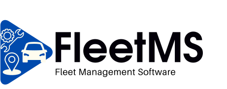
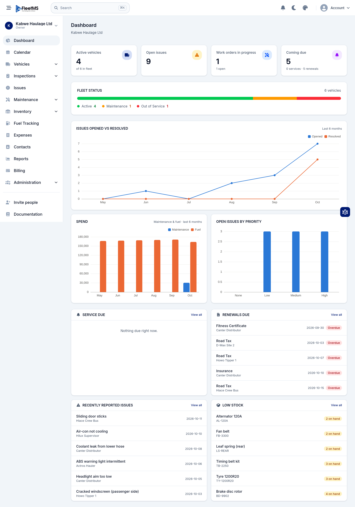
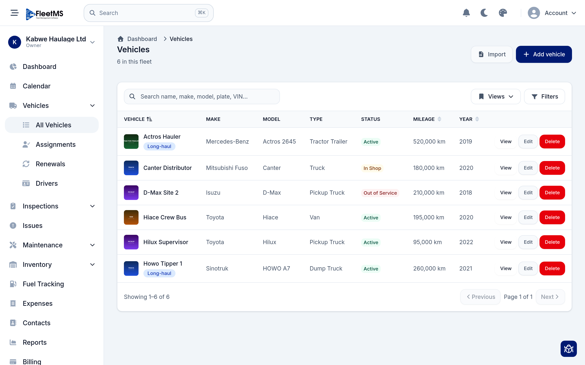
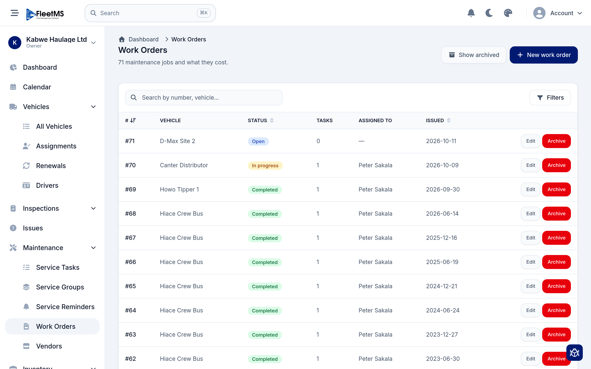
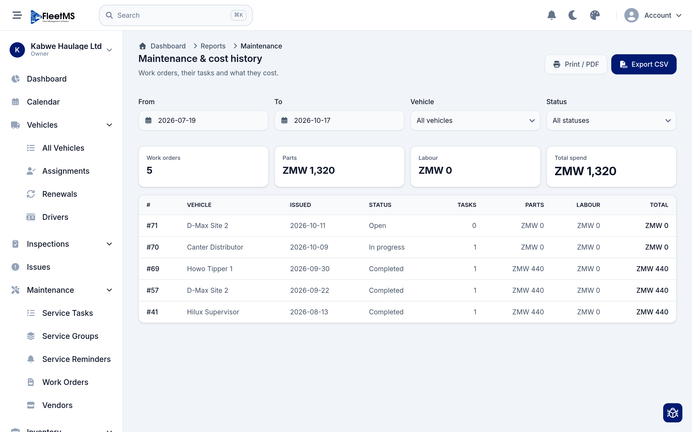
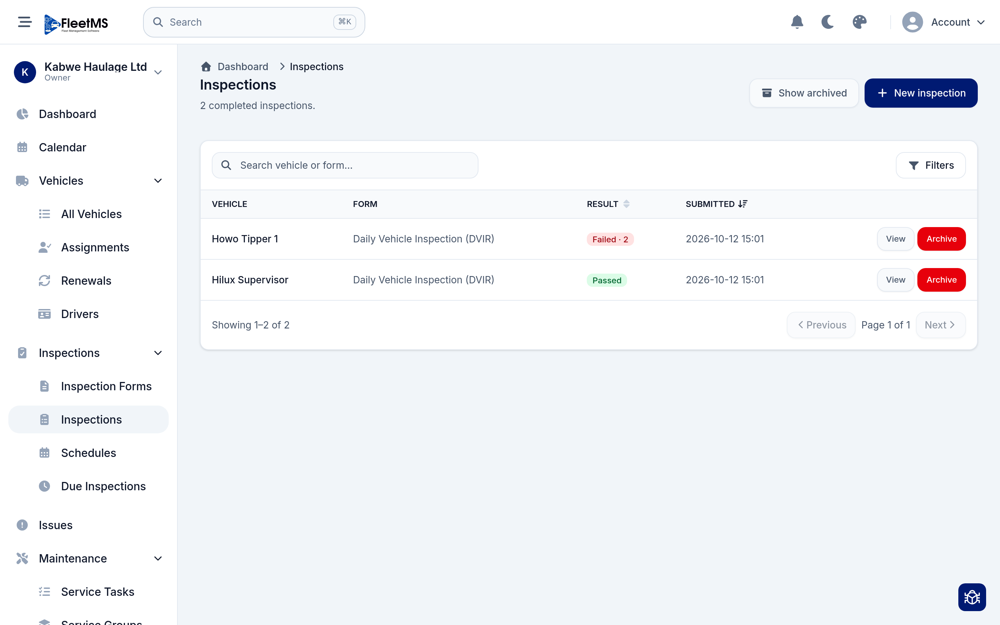
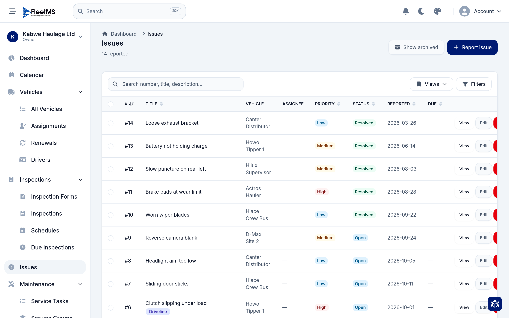
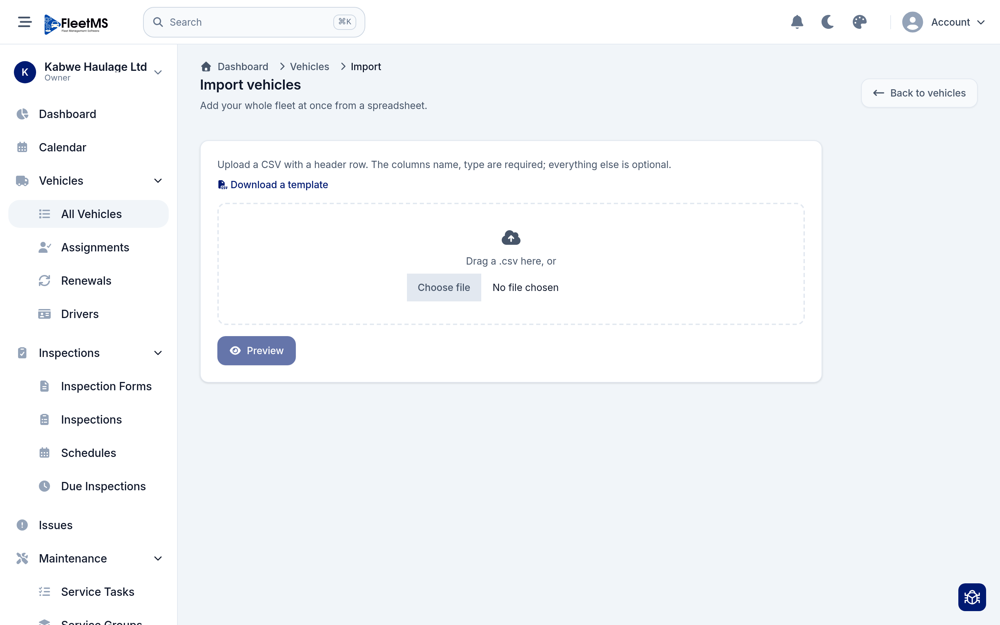

<p align="center">
  <picture>
    <source media="(prefers-color-scheme: dark)" srcset="priv/static/images/logo_dark.svg">
    
  </picture>
</p>

<h1 align="center">FleetMS</h1>

<p align="center">
  <strong>An open-source fleet maintenance &amp; management app — built to show what the <a href="https://ash-hq.org">Ash Framework</a> can do.</strong>
</p>

<p align="center">
  
  
  
  
</p>

---

FleetMS helps a business keep track of its vehicles and everything that keeps them
on the road: services and repairs, inspections, fuel, spare parts, driver
assignments, licence and insurance renewals, and the costs behind all of it. It is
a full web app, with a companion mobile app for drivers and field staff.

<p align="center">
  
</p>

## ⚠️ About this project — please read

This is a **learning and portfolio project**. Its main purpose is to be a thorough,
real-world example of building a non-trivial application with the **Ash Framework**
on Phoenix — multitenancy, authorization policies, background jobs, an audit trail,
a JSON API, and more, all wired together in one app.

A few honest things to set expectations:

- **It is not a "clone, configure, and ship" product.** There is no production
  customer running on it yet. Treat it as a reference you can read and learn from,
  not a turnkey system to deploy for a real fleet tomorrow.
- It is opinionated and still evolving. Some corners are polished, others are
  works in progress (see [Project status](#project-status)).
- If you are evaluating Ash for your own project and want to see how the pieces fit
  together at a realistic scale, this is meant to be a useful place to look.

With that out of the way — here is what it does.

## Features

**Vehicles**
- A central register of every vehicle, with make/model, status, mileage, photos and notes.
- **Bulk import from a CSV** so you can onboard an existing fleet in minutes.
- Driver assignments and a history of who drove what.
- Renewal tracking for licences, insurance, road tax and fitness certificates — with reminders.

**Maintenance**
- Work orders for repairs and scheduled services, with labour, parts and costs.
- Service tasks and service groups to standardise the jobs you do often.
- Service reminders based on time or mileage.

**Inspections**
- Build your own inspection forms (a drag-and-drop form builder).
- Drivers fill them in on the web or the mobile app.
- Schedule recurring inspections and assign them to drivers or vehicles.

**Issues**
- Report faults against a vehicle, discuss them in comments (with @mentions), and
  turn them into work orders.

**Inventory**
- Track spare parts, stock levels across locations, and get low-stock warnings.

**Fuel &amp; expenses**
- Log fuel-ups and other costs, and see spend per vehicle over time.

**Reports &amp; dashboard**
- A dashboard with fleet status, spend, open issues and what's coming due.
- Reports for maintenance, cost of ownership, fuel, and the driver roster.

**Running the organisation**
- Multiple organisations on one install, each with its own isolated data.
- Roles and permissions, team invitations, and per-user notification preferences.
- Your own units, currency, timezone and date format.
- A JSON API (with API keys) for integrations, and an admin console for staff.

## Screenshots

| | |
|---|---|
| **Vehicles** | **Work orders** |
|  |  |
| **Maintenance report** | **Inspections** |
|  |  |
| **Issues** | **Bulk vehicle import** |
|  |  |

## Why this is a nice showcase of Ash

Almost all of the application's behaviour lives in **Ash resources** — the data
model, the business rules, who can do what, and how it is all exposed. A quick tour
of the Ash features this project leans on:

| What you'll see | How it's done |
|---|---|
| **Multitenancy** — each organisation's data fully isolated | Schema-per-tenant with `AshPostgres`, scoped by the URL (`/o/:org_id`) |
| **Authorization** — roles and fine-grained permissions | `Ash.Policy.Authorizer` policies on every resource |
| **Authentication** — password login, invitations, API keys | `AshAuthentication` + `AshAuthentication.Phoenix` |
| **Background jobs** — reminders, recurring inspections | `AshOban` on top of Oban |
| **Audit trail** — history of changes with a timeline | `AshPaperTrail` |
| **Money** — costs and spend in the org's own currency | `AshMoney` / `ex_money` |
| **Public API** — a JSON:API for integrations | `AshJsonApi` |
| **Admin console** — staff tooling for free | `AshAdmin` |

Because the rules live in the resources, the Phoenix LiveViews stay thin: they call
**code interfaces** on the domains and render the result. If you want to understand
the app, start in `lib/fleetms/` (the domains and resources), not the web layer.

## Tech stack

- **Elixir** &amp; **Phoenix** (LiveView) for the web app
- **Ash Framework 3.x** for the domain model and business logic
- **PostgreSQL** as the database (schema-per-tenant multitenancy)
- **Tailwind CSS** + Flowbite for the UI, with a few **Svelte** islands for richer
  widgets (charts, the inspection form builder)
- **Oban** for background jobs
- **Flutter** for the [mobile app](mobile/) (offline-first, talks to the JSON API)

## Running it locally

**You will need:** Elixir ~> 1.15, Erlang/OTP, PostgreSQL 13+, and
[pnpm](https://pnpm.io/) for front-end assets.

```bash
# 1. Get the code
git clone https://github.com/jmnda-dev/fleetms.git
cd fleetms

# 2. Install dependencies, create and seed the database
mix setup

# 3. Start the server
mix phx.server
```

Then open <http://localhost:4000>.

The seed data creates a demo organisation ("Kabwe Haulage Ltd") you can sign in to:

| Email | Password |
|---|---|
| `manager@kabwehaulage.example` | `password1234` |

> The seeds are sample data for exploring the app — not real credentials.

## The mobile app

There is a Flutter app under [`mobile/`](mobile/) aimed at drivers and field staff:
sign in, see your vehicles, log fuel, run inspections and report issues — all
offline-first, syncing to the server through the JSON API when back online. See its
[README](mobile/README.md) to run it.

## Documentation

A task-oriented user manual lives in [`docs/manual/`](docs/manual/) — organised by
who you are (admin, driver) and what you're trying to get done.

## Project status

FleetMS is under active development. The core web app is feature-complete across the
modules above; the mobile app covers the driver/field-worker flows. Known areas
still in progress include manager-side mobile screens, single sign-on, and SMS
notifications. It has not yet been used by a real fleet in production.

## License

> **To be decided.** This repository is currently published without a license, which
> means default copyright applies (all rights reserved) until one is added. A license
> will be chosen before this is promoted for wider use.

---

<p align="center"><em>Built with Elixir, Phoenix and Ash. 🚚</em></p>
