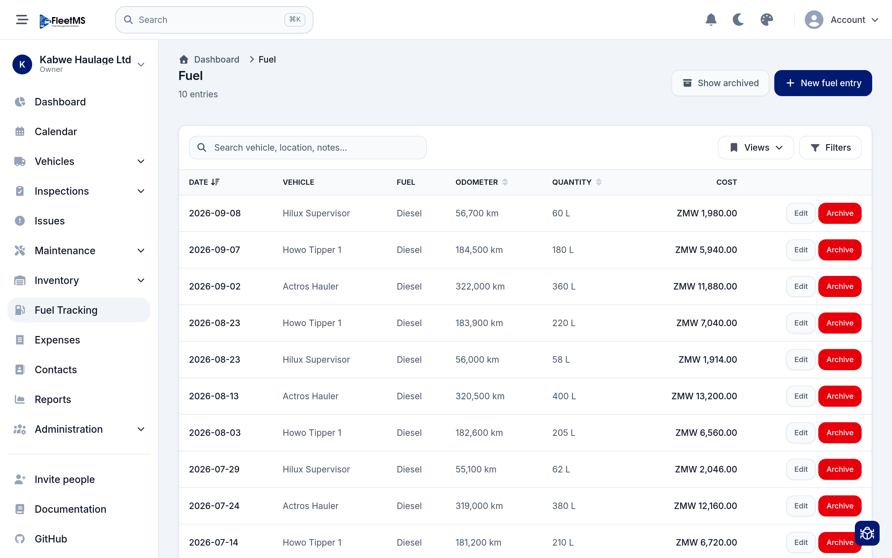
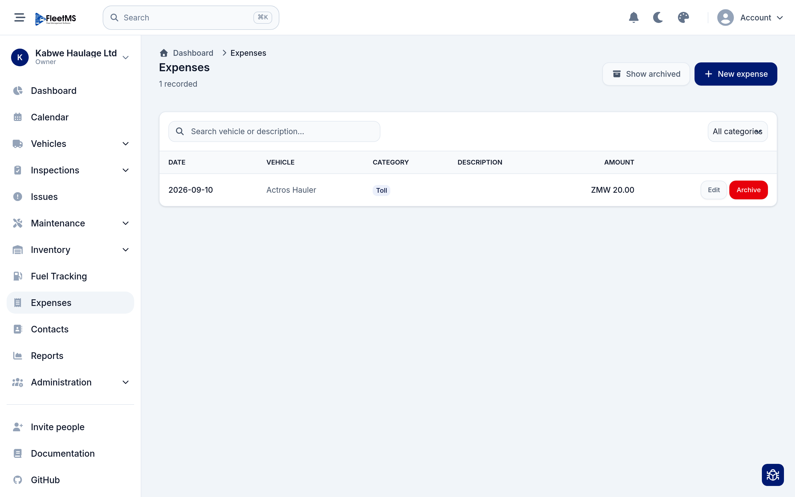
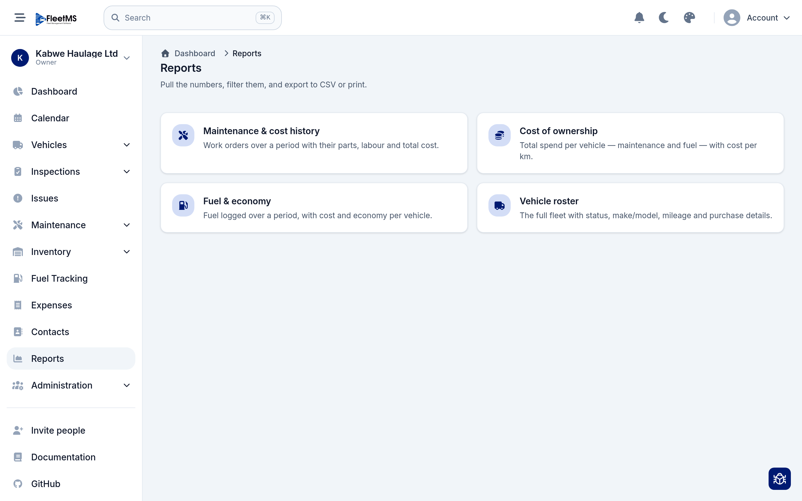
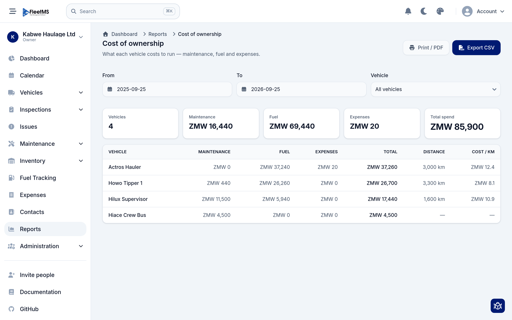
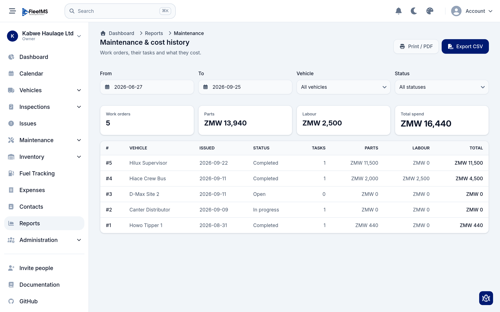
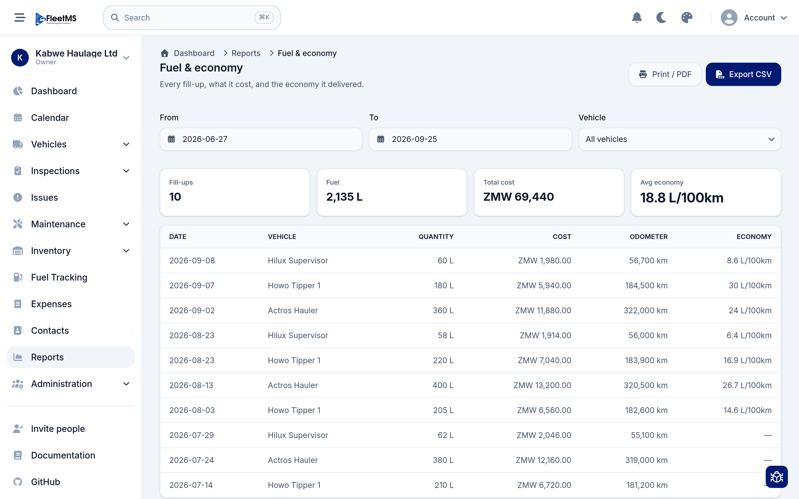

# Costs & reports (Admin / Owner)

FleetMS captures what each vehicle costs to run — fuel, maintenance and other
expenses — and turns it into reports you can filter, print and export. This guide
covers logging the costs and reading the reports that come out the other end.

It builds on [Day-to-day operations](day-to-day-operations.md), where maintenance
costs are captured on work orders.

**What's covered**

1. [Log fuel](#1-log-fuel)
2. [Log other expenses](#2-log-other-expenses)
3. [The reports hub](#3-the-reports-hub)
4. [Cost of ownership](#4-cost-of-ownership)
5. [Maintenance & cost history](#5-maintenance--cost-history)
6. [Fuel & economy](#6-fuel--economy)
7. [Vehicle roster](#7-vehicle-roster)

> **Where costs come from:** maintenance cost is captured on
> [work orders](day-to-day-operations.md#4-work-orders--the-job-and-its-cost),
> fuel cost on **Fuel Tracking**, and everything else on **Expenses**. The
> reports simply add these up per vehicle and per period.

---

## 1. Log fuel

Every fill-up is a fuel entry. Open **Fuel Tracking**.

Each entry records the **date**, **vehicle**, **fuel** type, the **odometer**
reading at fill-up, the **quantity** (litres), and the **cost**. Click **New fuel
entry** to add one — the odometer reading is important because it's what lets
FleetMS work out **fuel economy** (litres per 100 km) later.

Like other lists, you can **Search**, **Filter**, save a **View**, and **Show
archived** entries. Use **Edit** or **Archive** on any row.

> **Tip:** log fuel consistently — even a few missed odometer readings leave gaps
> in the economy figures. Drivers can add entries from their phone at the pump.

---

## 2. Log other expenses

Anything that isn't fuel or a work order — tolls, fines, parking, cleaning — goes
under **Expenses**.

Each expense has a **date**, the **vehicle** it belongs to, a **category** (for
example **Toll**), an optional **description**, and an **amount**. Click **New
expense** to add one, and use the **category** filter to narrow the list. These
amounts roll into the cost-of-ownership report alongside fuel and maintenance.

---

## 3. The reports hub

Open **Reports** from the sidebar to see everything available.

There are four reports:

| Report | What it answers |
| --- | --- |
| **Maintenance & cost history** | What have work orders cost over a period — parts, labour and total? |
| **Cost of ownership** | What does each vehicle cost to run in total, including cost per km? |
| **Fuel & economy** | How much fuel has each vehicle used, at what cost and economy? |
| **Vehicle roster** | The full fleet with status, make/model, mileage and purchase details. |

Every report can be filtered (by date range and vehicle), then **exported to
CSV** or sent to **Print / PDF** — so you can hand figures to an accountant, a
board, or a client.

---

## 4. Cost of ownership

This is the headline report: what each vehicle actually costs to run.

Set a **From** / **To** date range and, optionally, a single **vehicle**. The
summary cards give you the totals for the period — number of **vehicles**, and
spend split into **maintenance**, **fuel**, **expenses** and a **total spend**
(for example **ZMW 85,900**).

Below, the table breaks it down per vehicle: maintenance, fuel, expenses, total,
**distance** travelled, and **cost per km** — the single most useful number for
comparing vehicles and spotting the expensive ones. Export it to CSV to slice it
further in a spreadsheet.

---

## 5. Maintenance & cost history

A focused view of your work orders and what they cost.

Filter by date range, vehicle and **status**. The cards total **work orders**,
**parts**, **labour** and **total spend** for the period. The table lists each
work order with its vehicle, issued date, status, number of tasks, and the parts
/ labour / total cost — the same figures you see on each
[work order](day-to-day-operations.md#4-work-orders--the-job-and-its-cost),
gathered into one place.

---

## 6. Fuel & economy

Every fill-up, what it cost, and the economy it delivered.

The cards summarise the period: number of **fill-ups**, total **fuel** in litres,
**total cost**, and **average economy** (for example **18.8 L/100km**). The table
lists each fill-up with quantity, cost, odometer and the economy for that
interval — so you can spot a vehicle whose consumption is creeping up, which often
signals a developing fault.

> Economy is calculated from consecutive odometer readings, which is why
> [consistent fuel logging](#1-log-fuel) matters — a missing reading shows as a
> gap ("—") in the economy column.

---

## 7. Vehicle roster

The **Vehicle roster** report is a straightforward export of the whole fleet —
each vehicle with its status, make/model, mileage and purchase details. It's the
one to reach for when someone asks for "a list of all our vehicles" for
insurance, an audit, or a board pack. Filter it, then **Export CSV** or **Print /
PDF**.

---

## Where to go next

You can now see what your fleet costs and where the money goes. To make those
numbers complete and trustworthy:

- Keep **fuel** and **expenses** logged promptly (drivers can do both from their
  phones).
- Capture maintenance on **work orders** so it flows into the reports — see
  [Day-to-day operations](day-to-day-operations.md).
- **Inventory** (next) tracks parts and stock, and feeds parts cost into work
  orders.

See the [manual home](../README.md) for the full list of guides.
