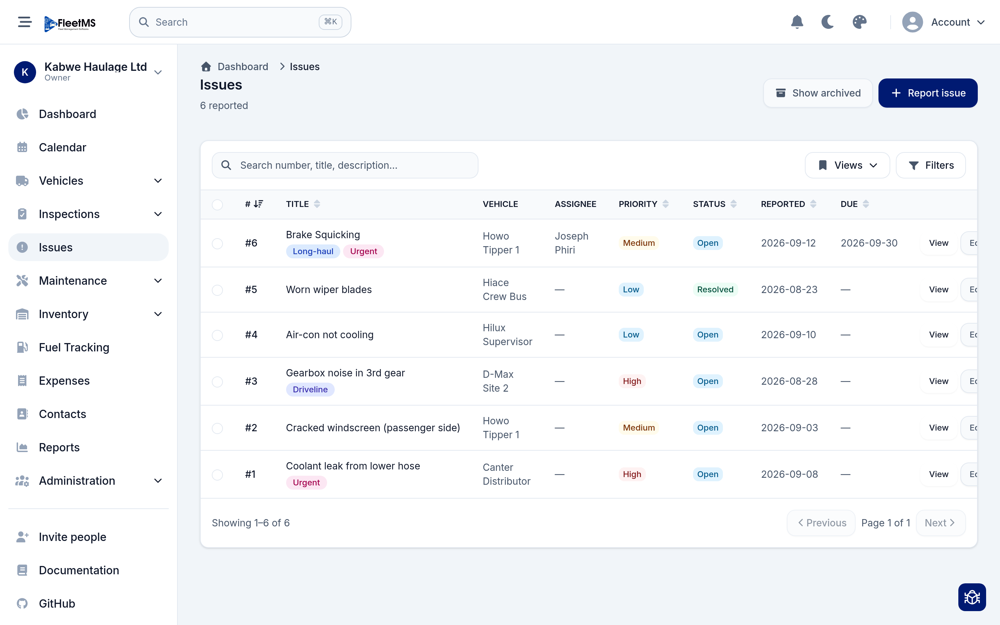
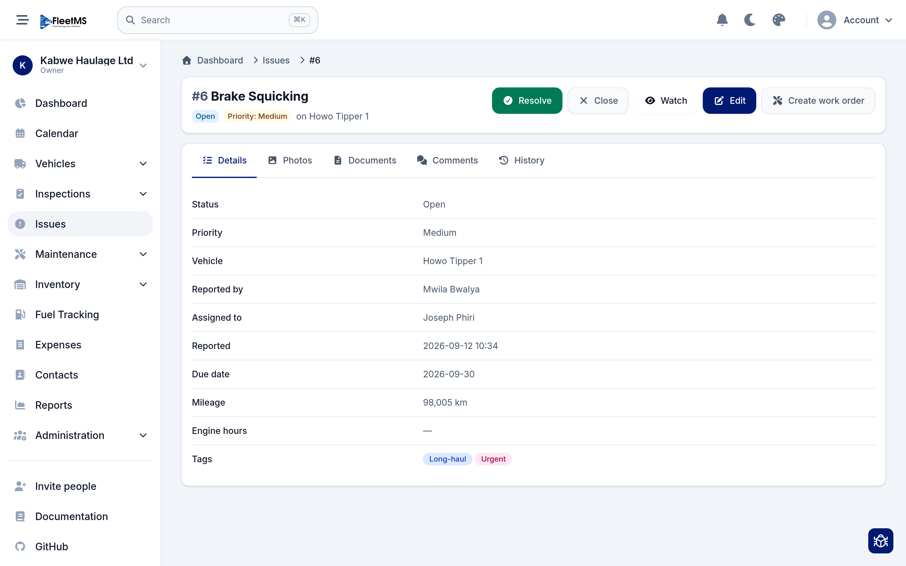
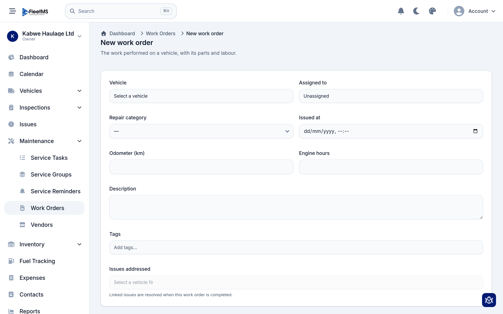
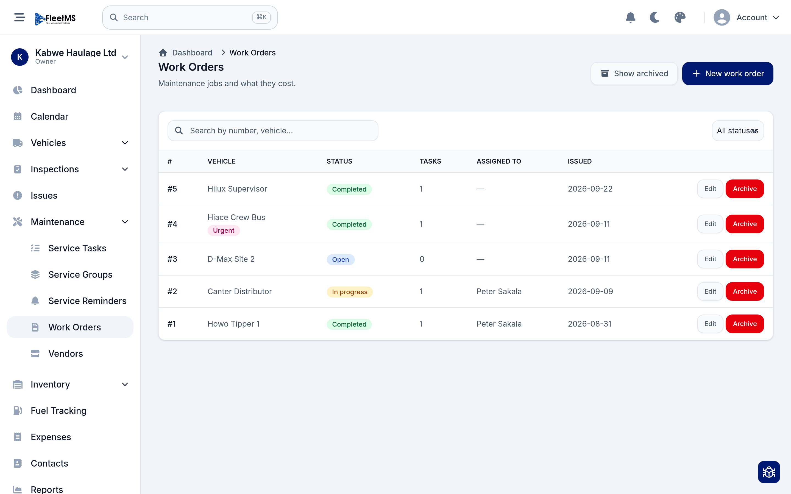
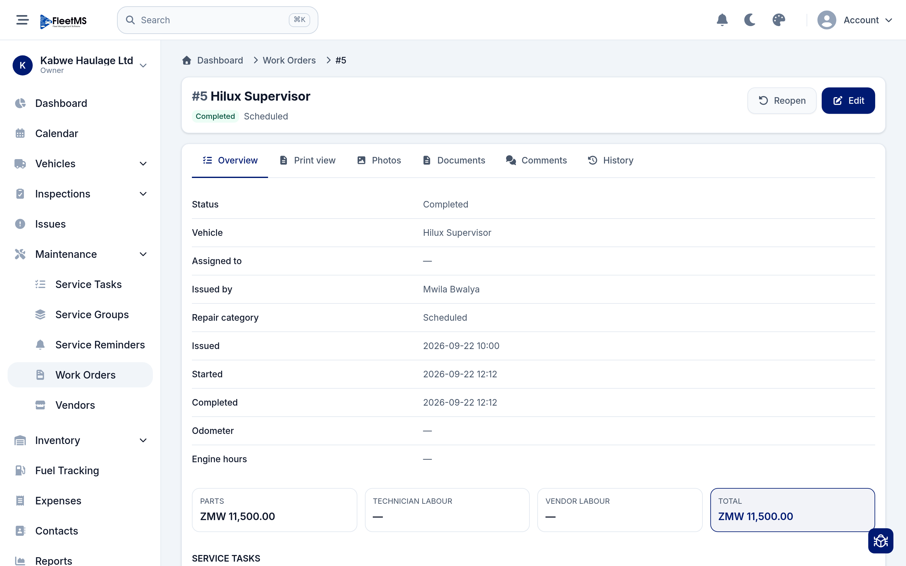
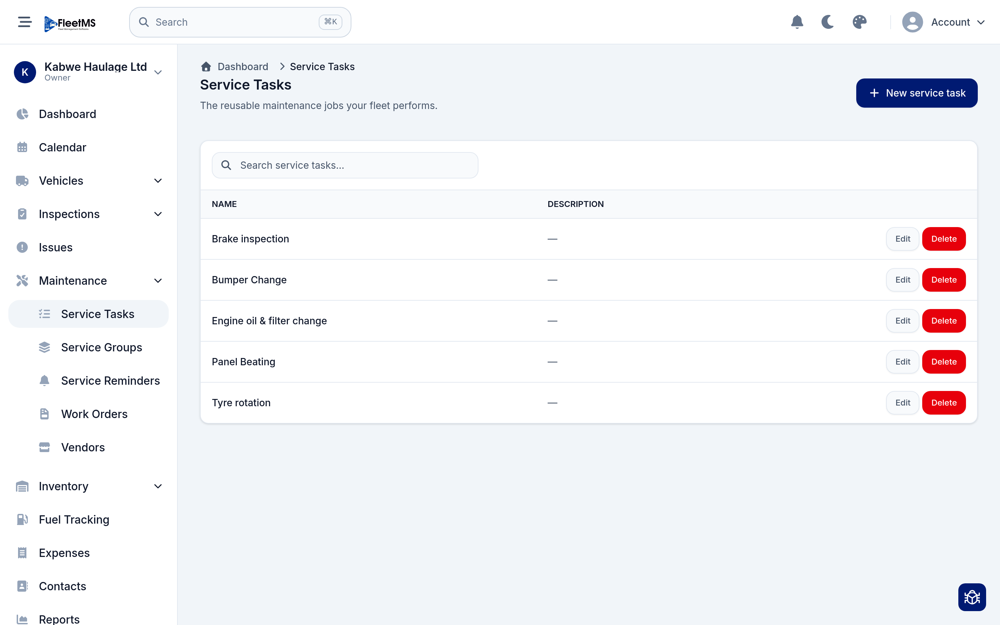
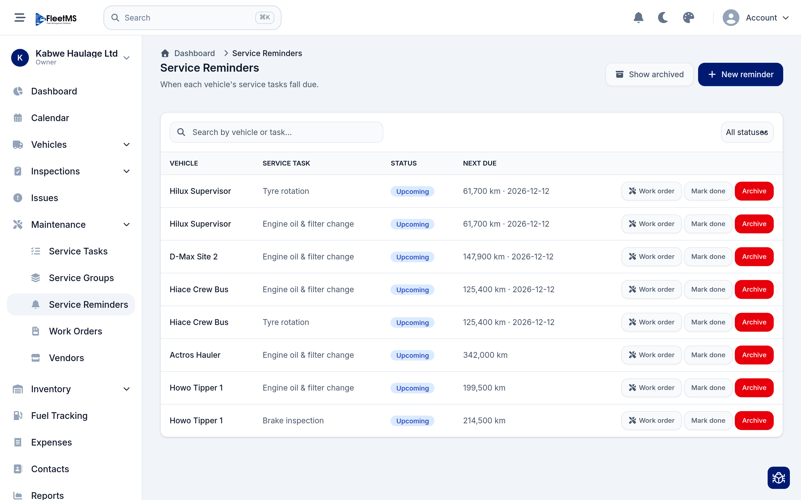

# Day-to-day operations: issues & maintenance (Admin / Owner)

This is the heartbeat of FleetMS: someone notices a problem, it gets recorded,
it becomes a repair, the repair gets done, and its cost is captured. This guide
walks that whole flow, then shows how to stay ahead of routine servicing so fewer
problems happen in the first place.

It follows on from [Managing your fleet](managing-fleet.md).

**What's covered**

1. [Report an issue](#1-report-an-issue)
2. [An issue's record](#2-an-issues-record)
3. [Turn an issue into a work order](#3-turn-an-issue-into-a-work-order)
4. [Work orders — the job and its cost](#4-work-orders--the-job-and-its-cost)
5. [Service tasks — your reusable jobs](#5-service-tasks--your-reusable-jobs)
6. [Service reminders — stay ahead of servicing](#6-service-reminders--stay-ahead-of-servicing)

---

## 1. Report an issue

An **issue** is anything wrong with a vehicle — a warning light, a strange noise,
a cracked windscreen. Open **Issues** from the sidebar.



Each issue has a number, a title, the vehicle it's on, an assignee, a
**priority** (Low / Medium / High) and a **status** (Open / Resolved / Closed),
plus when it was reported and when it's due. To raise a new one, click **Report
issue** and fill in:

- The **vehicle** it affects,
- A short **title** and a **description**,
- A **priority** and, optionally, a **due date** and an **assignee**.

Like other lists, you can **Search**, **Filter**, save a **View**, and **Show
archived** issues that have been tidied away.

> **Anyone can report** — issues are often raised by drivers doing an inspection
> or noticing a fault on the road, not just by the office. Getting them into the
> system is what makes sure nothing is forgotten.

---

## 2. An issue's record

Click **View** on an issue to open it.



The record shows everything about the problem — status, priority, vehicle, who
reported it, who it's assigned to, when it was reported, its due date, and the
**mileage / engine hours** at the time (useful context for a mechanic). The tabs
hold **Photos**, **Documents**, **Comments** (for discussion) and a **History**
audit trail.

Across the top are the actions:

- **Resolve** — mark the problem fixed.
- **Close** — close it without a fix (for example a duplicate or a non-issue).
- **Watch** — get notified of updates without being the assignee.
- **Edit** — change any of the details.
- **Create work order** — turn this issue into a scheduled repair. That's next.

---

## 3. Turn an issue into a work order

When an issue needs actual repair work, you promote it to a **work order** — the
record of the job, the parts and the labour. From the issue, click **Create work
order** (or go to **Maintenance → Work Orders → New work order**).



Fill in:

- The **vehicle** and who the job is **assigned to** (a mechanic, or leave it
  unassigned for now),
- A **repair category** and the **issued** date,
- The **odometer** / **engine hours** reading,
- A **description** and any **tags**,
- **Issues addressed** — link the issue(s) this job fixes.

> **The clever bit:** linked issues are **resolved automatically when the work
> order is completed**. Do the repair, close the job, and the original problem is
> marked fixed for you — no double bookkeeping.

---

## 4. Work orders — the job and its cost

**Maintenance → Work Orders** lists every maintenance job and what it cost.



Each row shows the number, vehicle, **status** (Open → In progress → Completed),
how many **tasks** it has, who it's assigned to, and the issued date. Use the
search box and the **All statuses** filter to find jobs, and **Show archived**
for finished ones you've filed away.

Open a work order to see the full picture:



The **Overview** tab lays out status, vehicle, who issued it, repair category,
and the issued / started / completed timestamps. Below that, the **cost
summary** breaks the job into **parts**, **technician labour** and **vendor
labour**, and totals it in your organization's currency (for example
**ZMW 11,500.00**). The **Service tasks** section lists the individual jobs done.
Other tabs give you a **Print view**, **Photos**, **Documents**, **Comments** and
**History**.

Use **Edit** to update the job as work progresses, and **Reopen** if a
"completed" job turns out to need more work.

> Because costs are captured per work order, **Reports** can later show you cost
> per vehicle, cost by repair category, and your total maintenance spend.

---

## 5. Service tasks — your reusable jobs

Rather than retyping "Engine oil & filter change" every time, you define it once
as a **service task** and reuse it. Open **Maintenance → Service Tasks**.



These are the reusable maintenance jobs your fleet performs — oil changes, tyre
rotations, brake inspections, panel beating, and so on. Click **New service
task** to add one. You then use these tasks inside work orders and service
reminders. (**Service Groups** let you bundle several tasks together, for example
a full "Major service".)

---

## 6. Service reminders — stay ahead of servicing

The best repair is the one you avoid. A **service reminder** says "this vehicle
is due for this task" based on distance or date, so you service on schedule
instead of after a breakdown. Open **Maintenance → Service Reminders**.



Each reminder pairs a **vehicle** with a **service task** and shows its **status**
(Upcoming, due, overdue) and **next due** — as a mileage, a date, or both (for
example *61,700 km · 2026-12-12*, whichever comes first). Click **New reminder**
to set one up.

When a reminder comes due you can act on it right from the row:

- **Work order** — spin up a work order for the task in one click.
- **Mark done** — record that it was serviced and roll the reminder forward to
  the next interval.
- **Archive** — retire a reminder you no longer need.

> Due and overdue reminders also surface on the **dashboard** and can send
> **notifications**, so servicing doesn't depend on someone remembering to open
> this page.

---

## The full loop

Put together, the day-to-day loop looks like this:

```
Someone reports an ISSUE
        │  Create work order (links the issue)
        ▼
   WORK ORDER  ──► parts + labour recorded ──► Completed
        │                                          │
        │                                   linked issue auto-resolved
        ▼
   Costs roll up into REPORTS

Meanwhile, SERVICE REMINDERS catch routine servicing
before it becomes an issue → one-click WORK ORDER.
```

## Where to go next

- **Fuel Tracking** and **Expenses** capture the other running costs, so
  **Reports** can show true cost of ownership per vehicle.
- **Inspections** let drivers check vehicles from their phones and raise issues
  automatically — closing the loop back to step 1.
- **Vendors** (under Maintenance) stores the garages and suppliers you assign
  vendor labour to.

Guides for these are being added. See the [manual home](../README.md) for the
full list.
