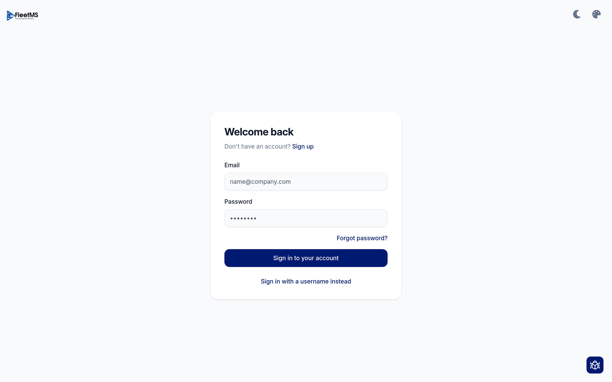
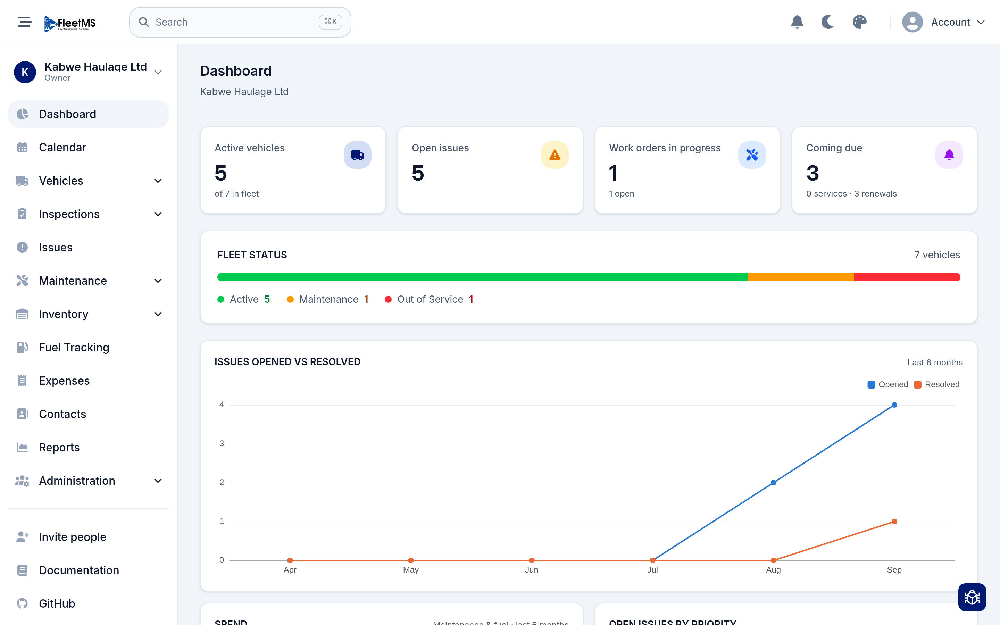
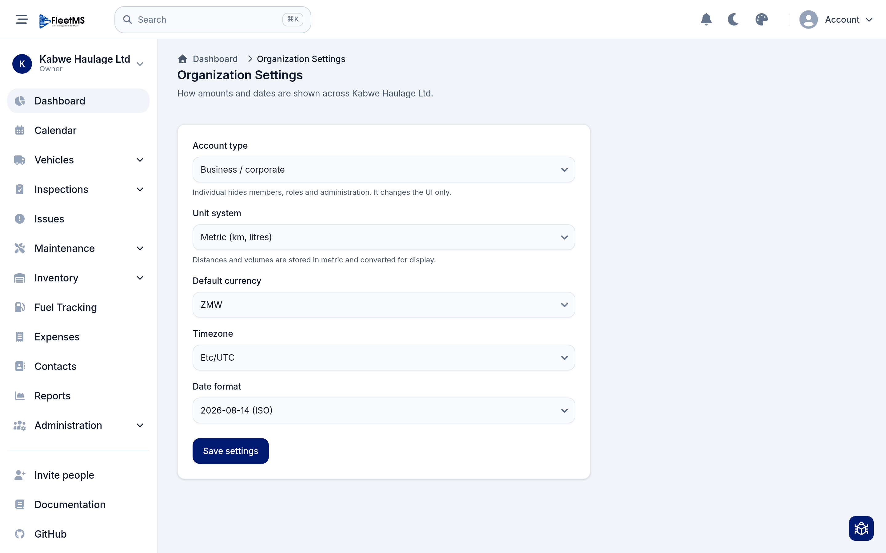
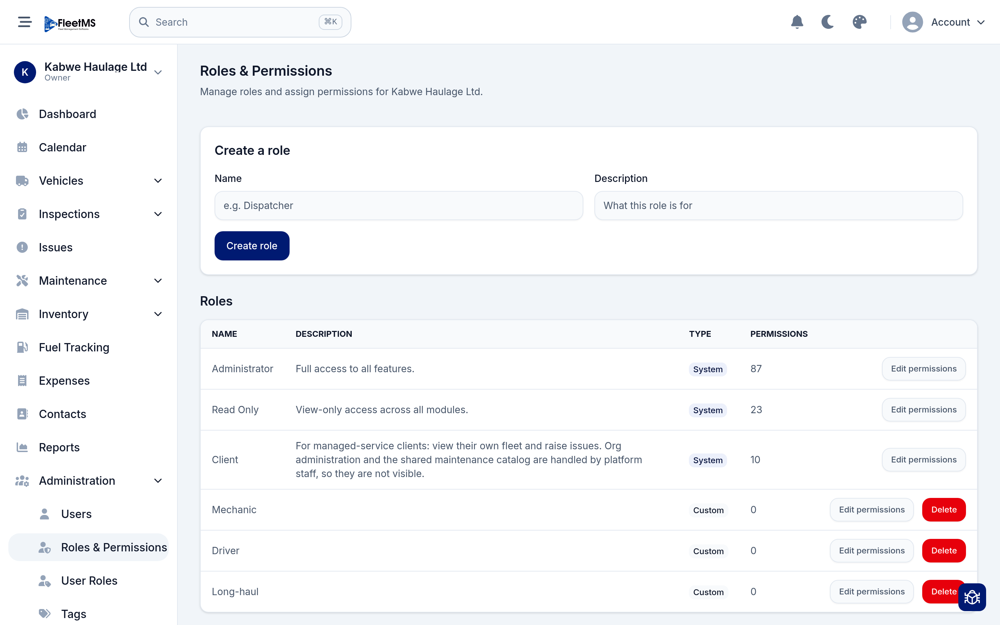
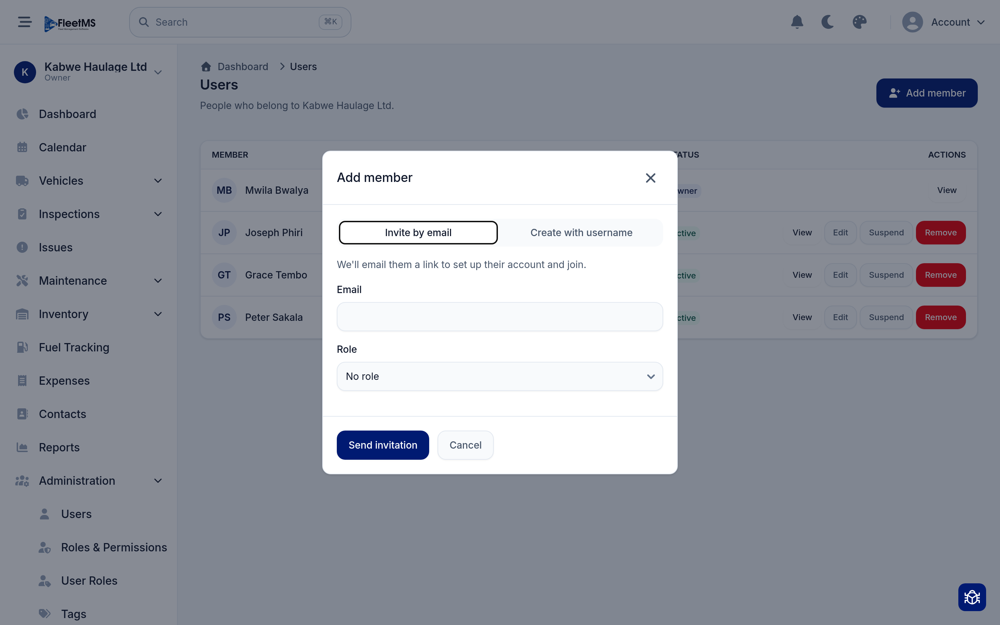
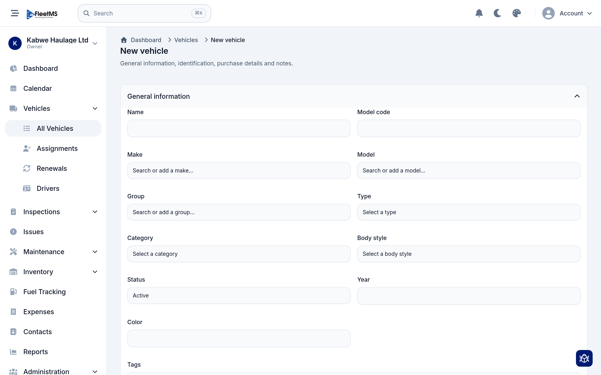

# Getting started (Admin / Owner)

This guide takes you from your first sign-in to a working organization: your
company set up, your team invited, and your first vehicle on the books. It is
written for the person who owns or administers the account.

You should be able to work through it in about 20 minutes. Each section is a
task you can do on its own, so feel free to skip ahead.

**What you'll do**

1. [Sign in](#1-sign-in)
2. [Find your way around](#2-find-your-way-around)
3. [Set up your organization](#3-set-up-your-organization)
4. [Decide who can do what: roles](#4-decide-who-can-do-what-roles)
5. [Invite your team](#5-invite-your-team)
6. [Add your first vehicle](#6-add-your-first-vehicle)
7. [Where to go next](#where-to-go-next)

---

## 1. Sign in

Open FleetMS in your browser and you'll land on the sign-in page.

1. Enter the **Email** and **Password** for your account.
2. Click **Sign in to your account**.

A few things worth knowing:

- **No password yet?** If someone invited you, you'll have received an email
  with a link to set your own password first. Follow that link, choose a
  password, and then come back here to sign in.
- **Forgot your password?** Click **Forgot password?** and we'll email you a
  reset link.
- **Sign in with a username instead** — some accounts (for example drivers who
  don't have a work email) sign in with a username rather than an email. Click
  this link to switch the form.

> **Tip:** You can switch between light and dark mode, and change the colour
> theme, using the moon and palette icons in the top-right corner — on the
> sign-in page and everywhere else in the app.

After you sign in, click **Go to dashboard** to enter your organization.

---

## 2. Find your way around

Once you're in, you'll see the dashboard. This is the home screen for your
organization, and every other screen is one click away from here.

The screen has three parts:

- **The sidebar (left)** is your main menu: Dashboard, Vehicles, Inspections,
  Issues, Maintenance, Inventory, Fuel Tracking, Expenses, Contacts, Reports and
  **Administration**. Items with a small arrow (like **Vehicles**) expand to
  show sub-pages.
- **The top bar** has global **Search** (press <kbd>⌘K</kbd> / <kbd>Ctrl K</kbd>
  from anywhere), your notifications, the light/dark and theme toggles, and the
  **Account** menu.
- **The organization switcher** sits at the top of the sidebar. It shows the
  organization you're currently in ("Kabwe Haulage Ltd" in the screenshots) and
  your role in it ("Owner"). If you belong to more than one organization, click
  it to switch between them.

The dashboard itself gives you an at-a-glance read on the fleet: how many
vehicles are active, open issues, work orders in progress, what's coming due,
and trends over the last few months. It fills in on its own as you and your team
start using the system — so don't worry that it looks quiet on day one.

---

## 3. Set up your organization

Before you add data, set your organization's defaults so that money, distances
and dates show up the way your team expects. Open **Administration → Organization
Settings** (or search for "organization settings").

There are five settings here:

| Setting | What it controls |
| --- | --- |
| **Account type** | **Business / corporate** shows the full app (members, roles, administration). **Individual** hides those and simplifies the UI for a one-person account. This changes the UI only — your data is untouched. |
| **Unit system** | **Metric (km, litres)** or **Imperial (miles, gallons)**. Distances and volumes are always *stored* in metric and converted for display, so you can change this later without corrupting your history. |
| **Default currency** | The currency new costs default to — for example **ZMW**. |
| **Timezone** | Used when showing dates and times. |
| **Date format** | How dates are written across the app (for example ISO `2026-08-14`). |

Choose your values and click **Save settings**. You can come back and change any
of these at any time.

---

## 4. Decide who can do what: roles

FleetMS controls access with **roles**. A role is a named bundle of permissions
(for example "can view vehicles", "can create issues"). You give people roles;
the role decides what they can see and do.

Open **Administration → Roles & Permissions**.

### The built-in (system) roles

Every organization starts with a few **System** roles you can't delete. They're
kept in sync automatically as new features ship:

- **Administrator** — full access to everything.
- **Read Only** — can view every module but change nothing. Good for auditors,
  accountants or an owner who just wants visibility.
- **Client** — a limited role for managed-service customers who only need to see
  their own fleet and raise issues.

> The **Owner** of the organization always has full access, regardless of roles.

### Creating your own roles

Most teams want roles that match how they actually work — a **Driver**, a
**Mechanic**, a **Dispatcher**. To create one:

1. Under **Create a role**, type a **Name** (for example `Dispatcher`) and an
   optional **Description**.
2. Click **Create role**. It appears in the list as a **Custom** role.
3. Click **Edit permissions** next to it and tick exactly what that role should
   be able to do, then save.

You can edit a custom role's permissions whenever your needs change, and delete
a custom role you no longer use. (System roles can have their permissions
reviewed but not deleted.)

> **Do this before you invite people** — then you can assign the right role as
> you invite each person, instead of going back to fix it later.

---

## 5. Invite your team

With your roles ready, bring your team in. Open **Administration → Users**, then
click **Add member**.

You have two ways to add someone, shown as tabs:

- **Invite by email** — enter their **Email**, pick a **Role**, and click **Send
  invitation**. FleetMS emails them a link to set up their own account and join.
  This is the usual choice for office staff and managers.
- **Create with username** — for people without a work email (commonly drivers).
  You set them up directly with a username, and hand them their sign-in details.

Choose a **Role** for the person as you invite them (you set these up in the
previous step). You can change it later.

### Managing people afterwards

Back on the **Users** list you can, for each member:

- **View** or **Edit** their details,
- **Suspend** them — they keep their account but can't sign in until you
  reactivate them (useful when someone leaves temporarily),
- **Remove** them from the organization.

Their **Status** column shows who is active at a glance.

---

## 6. Add your first vehicle

Now the reason you're here — your fleet. Open **Vehicles → All Vehicles** and
click **New vehicle** (or search for "new vehicle").

The form is grouped into sections — **General information**, identification,
purchase details and notes — so you only fill in what's relevant. To get a
vehicle on the books, the essentials are:

- **Name** — how you'll refer to it (for example a fleet number or nickname).
- **Make** and **Model** — start typing and pick from the list, or add a new one
  on the fly if it isn't there yet.
- **Status** — defaults to **Active**. Use the other statuses (in maintenance,
  out of service, sold, etc.) as the vehicle's situation changes.

Everything else — **Group**, **Type**, **Category**, **Body style**, **Year**,
**Color**, **Tags**, licence plate / VIN, and purchase details — is optional and
can be filled in now or later. The more you add, the more useful your reports and
reminders become, but you don't have to complete it all today.

Save the vehicle and it appears in **All Vehicles**. From there you can record
inspections, log issues, schedule maintenance, track fuel and assign drivers
against it.

> **Tip:** Add a handful of vehicles first, then explore the **Vehicles**
> sub-menu — **Assignments** (who's driving what), **Renewals** (licences,
> insurance and other dates that expire) and **Drivers**.

---

## Where to go next

You now have a working organization: your defaults are set, your roles reflect
how your team works, your people are invited, and your fleet is taking shape.

Good next steps:

- **Add the rest of your vehicles**, then set up **Renewals** so you're warned
  before licences and insurance expire.
- **Build an inspection form** under **Inspections** so drivers can check
  vehicles from their phones.
- **Log your first issue** when something needs attention, and turn it into a
  work order under **Maintenance**.
- Explore **Reports** once you have a few weeks of data.

More sections of this manual — for managers and for drivers — are on the way. If
something in the app isn't covered here yet, the **Documentation** link in the
sidebar always points to the latest help.
