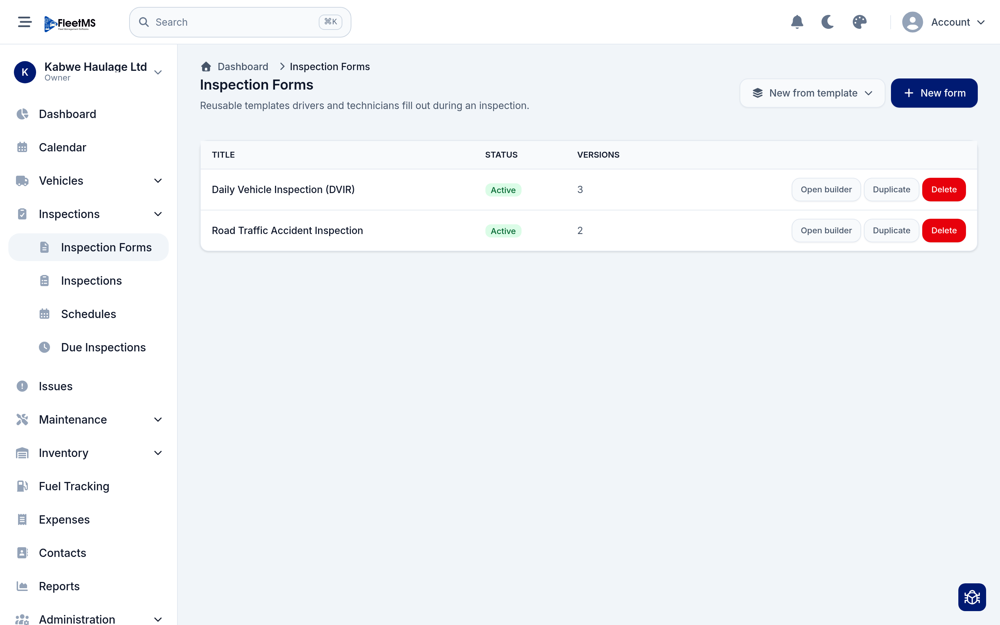
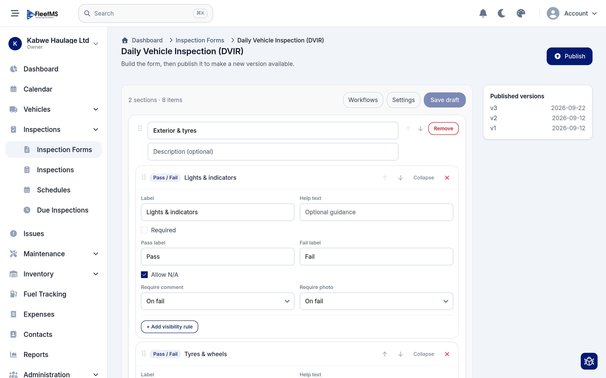
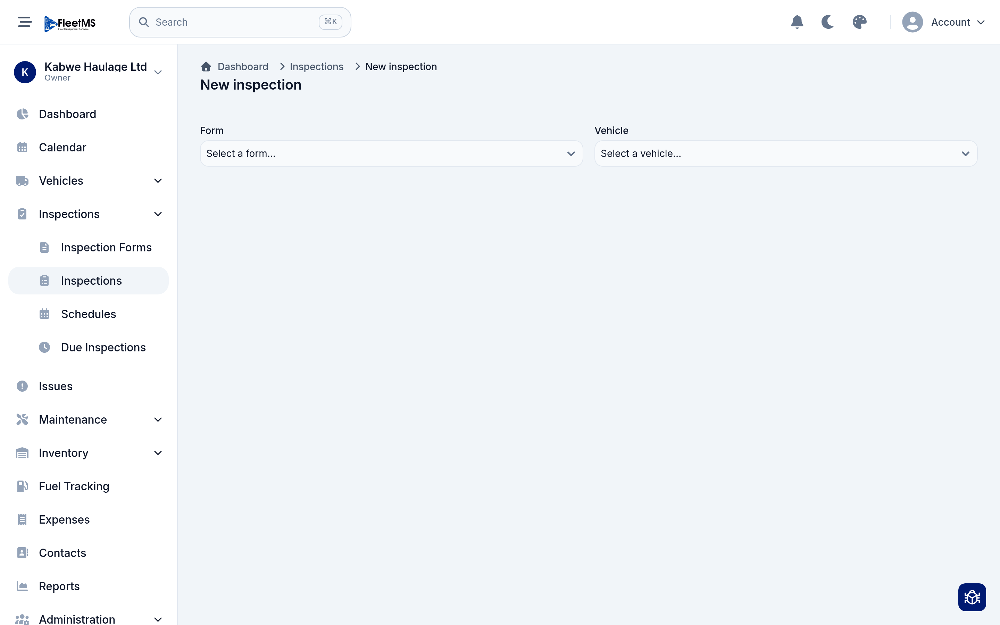
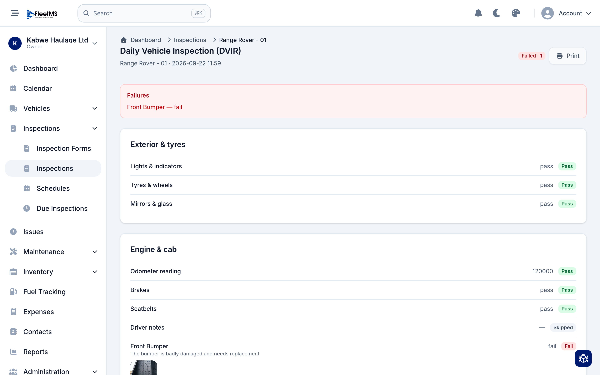
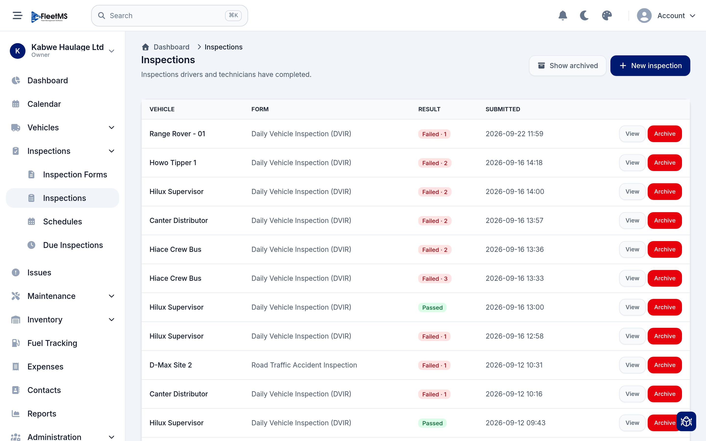
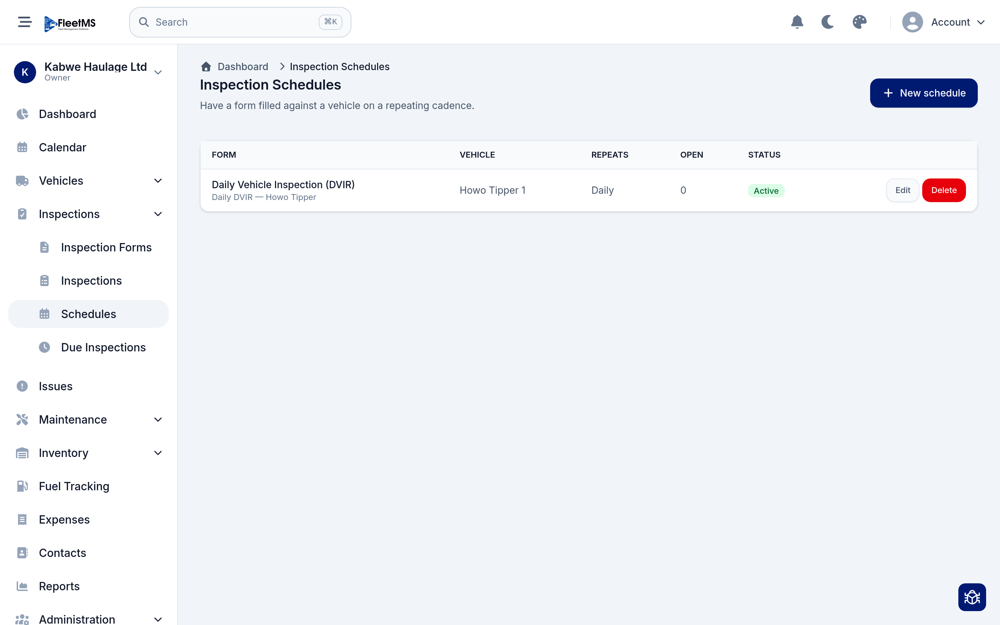

# Inspections (Admin / Owner)

Inspections are the checks your drivers and technicians run on a vehicle — a
daily walk-around (DVIR), a post-accident report, a pre-trip check. You design
the checklist once, people fill it in (from a phone, at the vehicle), and every
failed item is captured with a comment and a photo so nothing gets lost.

This guide follows on from
[Day-to-day operations](day-to-day-operations.md); inspections are how problems
get *found* before they become breakdowns.

**What's covered**

1. [Inspection forms](#1-inspection-forms)
2. [Building a form](#2-building-a-form)
3. [Running an inspection](#3-running-an-inspection)
4. [Reviewing a submission](#4-reviewing-a-submission)
5. [The inspections list](#5-the-inspections-list)
6. [Schedules & due inspections](#6-schedules--due-inspections)

---

## 1. Inspection forms

A **form** is a reusable checklist template. Open **Inspections → Inspection
Forms**.

Each form shows its title, whether it's **Active**, and how many **versions**
it has. To create one you can:

- **New from template** — start from a ready-made checklist (like a standard
  DVIR) and adjust it, or
- **New form** — start from a blank form.

You can also **Duplicate** an existing form to base a new one on it, or **Delete**
one you don't need. To edit a form's content, click **Open builder**.

> **Versions matter.** Forms are versioned. When you change a form and publish
> it, a new version is created — but inspections already submitted keep the exact
> version they were filled on, so your history never changes underneath you.

---

## 2. Building a form

The builder is where you lay out the checklist. It's organised into **sections**,
and each section holds **items** (the individual things to check).

**Sections** group related checks — "Exterior & tyres", "Engine & cab". Give each
a title and an optional description, and drag them into the order you want.

**Items** are the questions. Each item has a **type** — for example **Pass /
Fail**, a number reading (like an odometer), or a free-text note. For a Pass/Fail
item you can set:

- A **label** and optional **help text** to guide the person filling it in.
- Whether it's **Required**.
- Custom **Pass** and **Fail** labels, and whether to **Allow N/A**.
- **Require comment** and **Require photo** — set these to **On fail** so that
  whenever someone marks an item as failed, they *must* explain it and attach a
  photo. This is what makes the results actionable.
- A **visibility rule** — show an item only when an earlier answer has a certain
  value (for example, only ask "describe the damage" if "bodywork" failed).

When you're happy, use **Save draft** to keep working, or **Publish** to make the
new version available to fill. The **Published versions** panel on the right lists
every version and when it went live. **Workflows** and **Settings** control what
happens on submission and other form-wide options.

---

## 3. Running an inspection

An inspection is usually done *at the vehicle*, often on a phone. To start one,
open **Inspections → Inspections** and click **New inspection**.

Pick the **form** and the **vehicle**, and the checklist opens for the person to
work through — marking each item Pass / Fail / N/A, entering readings, and adding
the comments and photos the form requires. When they submit, it's recorded
against that vehicle.

> Because the app is responsive and installable (a PWA), drivers can do this
> from their phone at the vehicle, even filling readings and taking photos on the
> spot.

---

## 4. Reviewing a submission

Open any inspection to see the completed checklist.

At the top you get the overall result — for example **Failed · 1** — and, when
there are failures, a **Failures** summary listing exactly what didn't pass. Below
that, every section and item is shown with its answer and a badge:

- **Pass** (green), **Fail** (red), or **Skipped**.
- Number readings (like the odometer) are shown with their value.
- A failed item shows the **comment** and **photo** the inspector attached — so
  you can see *the bumper is badly damaged* and the picture of it, without
  chasing anyone.

Use **Print** for a paper or PDF copy (handy for compliance records).

> **Closing the loop:** a failed inspection item is a problem that needs fixing.
> Raise an [issue](day-to-day-operations.md#1-report-an-issue) from it, then turn
> that into a [work order](day-to-day-operations.md#3-turn-an-issue-into-a-work-order)
> — the same operational flow from the previous guide.

---

## 5. The inspections list

**Inspections → Inspections** is the record of everything that's been submitted.

Each row shows the **vehicle**, the **form** used, the **result** (Passed, or
Failed with the number of failed items) and when it was **submitted**. Click
**View** to open a submission, or **Archive** to file away old ones (**Show
archived** brings them back). This is your at-a-glance safety and compliance
history for the whole fleet.

---

## 6. Schedules & due inspections

You don't want to rely on people remembering to inspect. A **schedule** has a form
filled against a vehicle on a repeating cadence. Open **Inspections → Schedules**.

Each schedule pairs a **form** with a **vehicle**, sets how often it **repeats**
(for example **Daily**), and shows how many are currently **open** and whether the
schedule is **Active**. Click **New schedule** to set one up.

The **Due Inspections** page (also under Inspections) then shows what's currently
due, so a driver or manager can see at a glance which checks still need doing
today.

---

## Where to go next

Inspections feed straight back into the operational loop:

- Failed items become **issues**, which become **work orders** — see
  [Day-to-day operations](day-to-day-operations.md).
- Odometer readings captured during inspections keep your mileage current, which
  drives **service reminders**.

Other guides — costs & reports, inventory, and the people/admin sections — are
being added. See the [manual home](../README.md) for the full list.
