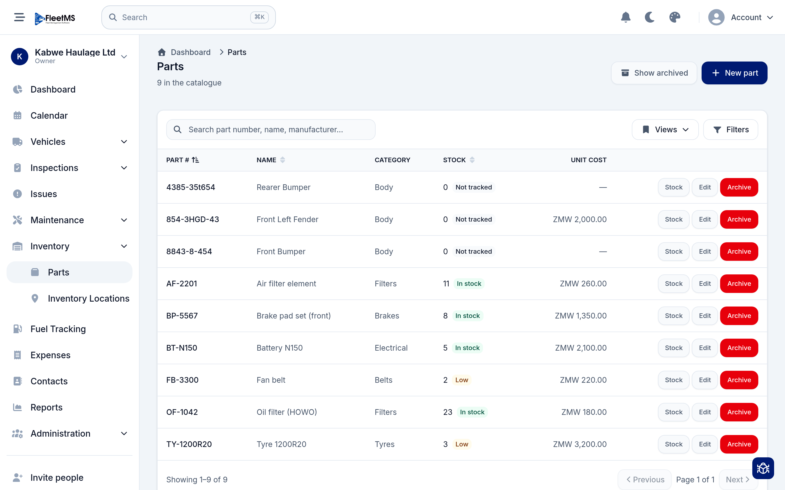
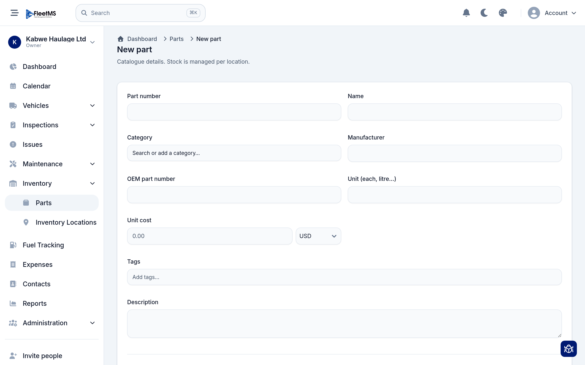
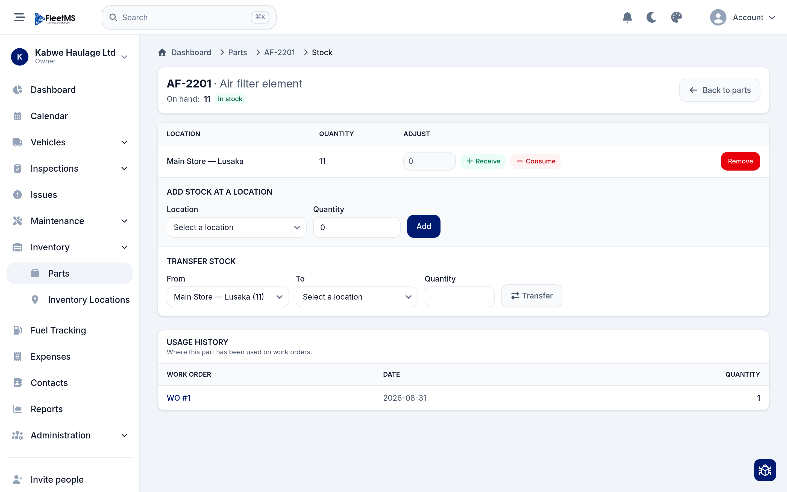
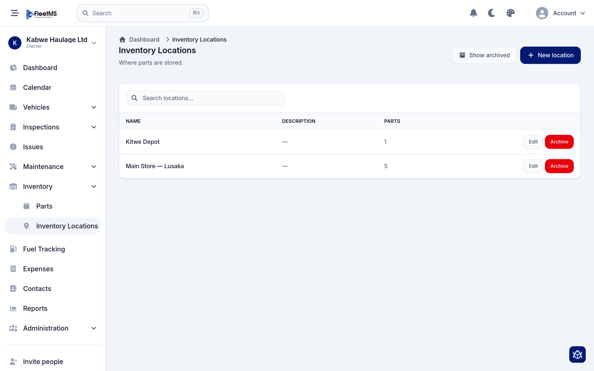

# Inventory (Admin / Owner)

Inventory is your parts catalogue and stock control: what parts you buy, how many
you have, where they're kept, and how they get used up on repairs. Keeping it
current means a mechanic can see at a glance whether the filter they need is on
the shelf — and the cost of every part flows through to your reports.

This guide builds on
[Day-to-day operations](day-to-day-operations.md), where parts are consumed on
work orders, and [Costs & reports](costs-and-reports.md), where their cost shows
up.

**What's covered**

1. [The parts catalogue](#1-the-parts-catalogue)
2. [Adding a part](#2-adding-a-part)
3. [Tracking stock](#3-tracking-stock)
4. [Moving stock between locations](#4-moving-stock-between-locations)
5. [Inventory locations](#5-inventory-locations)
6. [How parts connect to work orders](#6-how-parts-connect-to-work-orders)

> **Catalogue vs. stock — the key idea.** A **part** is a catalogue entry (the
> *kind* of thing — "Air filter element", part number AF-2201). **Stock** is how
> many of that part you physically have, counted **per location**. One part, many
> locations, each with its own quantity.

---

## 1. The parts catalogue

Open **Inventory → Parts**. This is every part you stock or buy.

Each row shows the **part number**, **name**, **category** (Body, Filters,
Brakes, Tyres…), the current **stock** and its **unit cost**. The stock column
carries a status badge:

- **In stock** (green) — you have some.
- **Low** (amber) — you're running down and should reorder.
- **Not tracked** — a part you list but don't count (for example a body panel you
  always buy to order).

Use **Search**, save a **View**, and **Filter** to find parts. **New part** adds
one; each row has **Stock** (manage quantities — see below), **Edit** and
**Archive**.

---

## 2. Adding a part

Click **New part**. This creates the catalogue entry only — *"Stock is managed
per location"*, which you do afterwards.

Fill in:

- **Part number** and **Name** (the essentials),
- **Category** — pick one or add a new one on the fly,
- **Manufacturer** and **OEM part number** for cross-referencing,
- **Unit** (each, litre…) and **Unit cost** with its currency,
- **Tags** and a **Description**.

Save it, and the part appears in the catalogue with **0** stock until you add
some.

---

## 3. Tracking stock

Click **Stock** on any part to manage its quantities. This is where the
per-location counting happens.

At the top you see the total **On hand** across all locations and its status
badge. The table lists each **location** holding this part with its **quantity**,
and lets you adjust it:

- **+ Receive** — book in stock you've bought (type the amount, then Receive).
- **− Consume** — take stock out by hand (Receive/Consume are also how you correct
  a miscount).
- **Remove** — stop stocking the part at that location.

To stock the part somewhere new, use **Add stock at a location** — pick the
location, enter a quantity, and **Add**.

The **Usage history** at the bottom shows every work order this part has been used
on, with the date and quantity — so you can trace where your stock went.

---

## 4. Moving stock between locations

If you have more than one store, the stock page also has a **Transfer stock**
panel. Choose the **From** location, the **To** location, and a **quantity**, then
**Transfer** — the amount moves from one location's count to the other in a single
step. Useful when you move parts from a central store out to a depot.

---

## 5. Inventory locations

Locations are the places you keep parts — a main store, a depot, a workshop van.
Open **Inventory → Inventory Locations**.

Each location shows its **name**, an optional **description**, and how many
**parts** are stocked there. Click **New location** to add one (for example
*Main Store — Lusaka* or *Kitwe Depot*), and **Edit** or **Archive** existing
ones. You need at least one location before you can hold any stock.

---

## 6. How parts connect to work orders

Inventory isn't a silo — it's wired into maintenance and costs:

- When a part is added to a
  [work order](day-to-day-operations.md#4-work-orders--the-job-and-its-cost), its
  **cost** counts toward that job's parts total.
- That usage is recorded in the part's **Usage history**, so stock and repairs
  stay reconciled.
- The **unit cost** you set on the part is what drives the parts figures in the
  [maintenance and cost-of-ownership reports](costs-and-reports.md).

So the loop is: **buy parts → receive into stock → consume on work orders →
cost lands in reports**, with **Low** badges nudging you to reorder before you run
out.

---

## Where to go next

- Keep an eye on **Low** parts and reorder so repairs are never held up waiting
  for stock.
- Set unit costs accurately — they feed straight into your
  [cost reports](costs-and-reports.md).
- Record parts on **work orders** as you use them, so stock and spend both stay
  true — see [Day-to-day operations](day-to-day-operations.md).

See the [manual home](../README.md) for the full list of guides.
