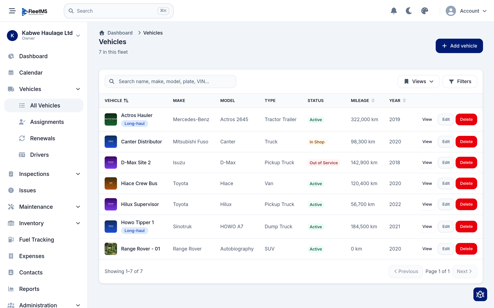
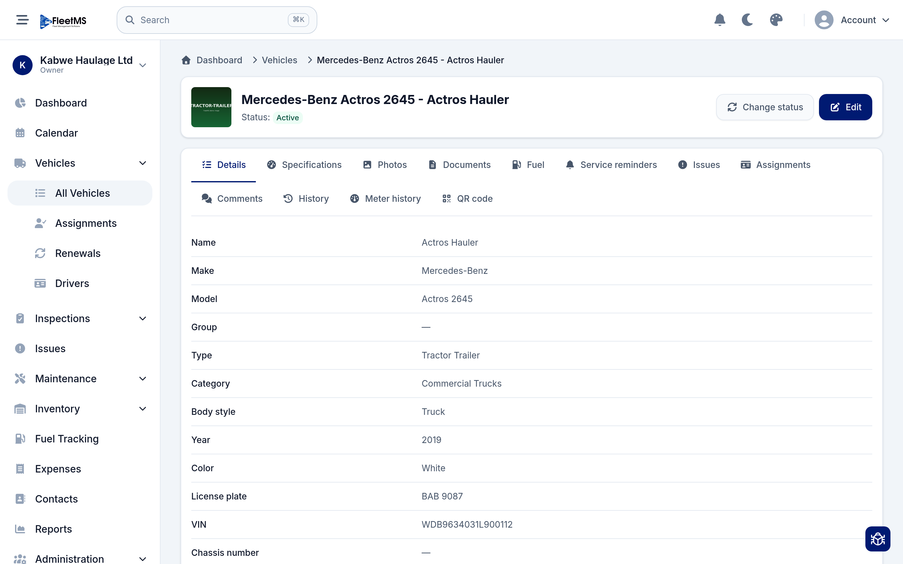
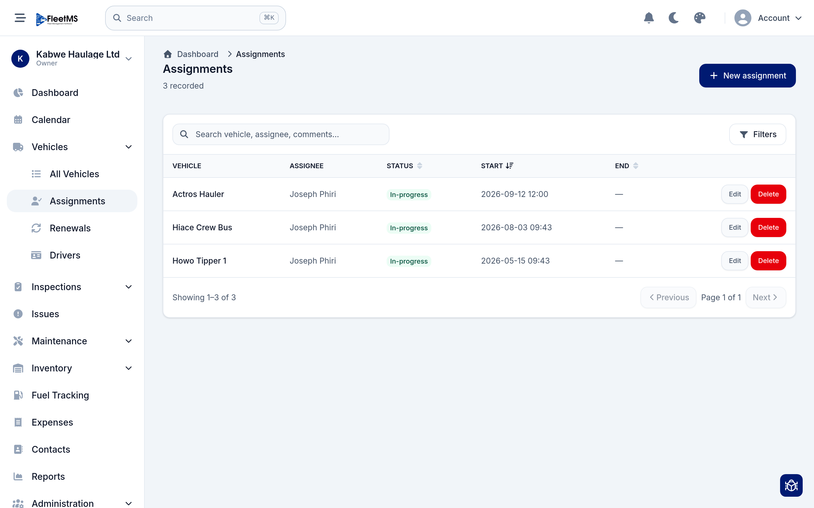
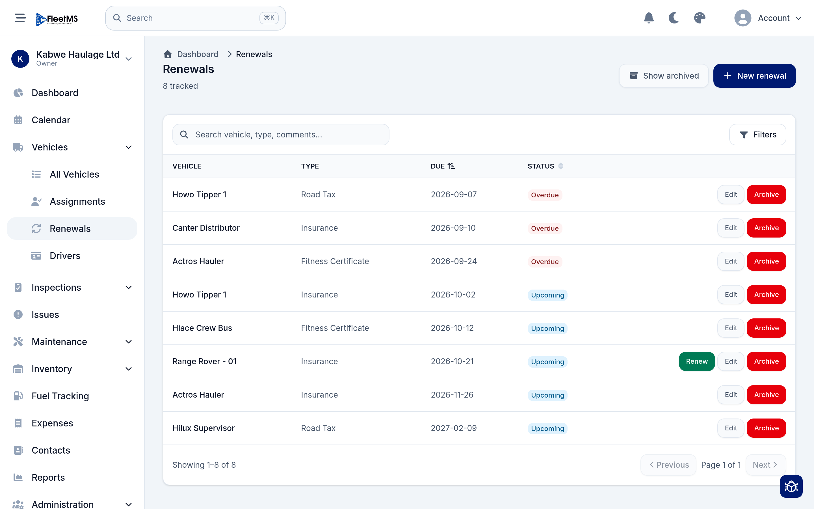
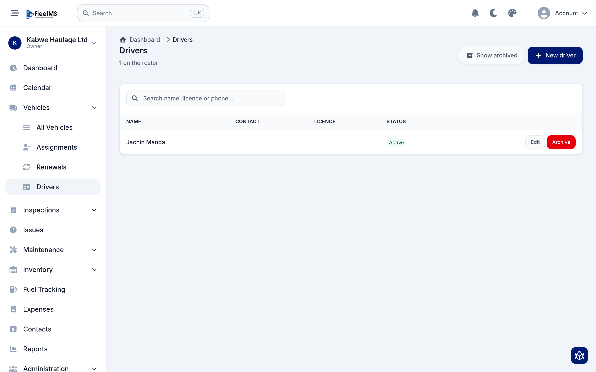

# Managing your fleet (Admin / Owner)

Once your vehicles are in FleetMS, this is where you'll spend most of your time:
keeping vehicle records up to date, tracking who's driving what, and staying
ahead of licences and certificates before they expire.

This guide follows on from [Getting started](getting-started.md), step 6. If you
haven't added a vehicle yet, do that first.

**What's covered**

1. [The vehicles list](#1-the-vehicles-list)
2. [A vehicle's record](#2-a-vehicles-record)
3. [Changing a vehicle's status](#3-changing-a-vehicles-status)
4. [Assignments — who's driving what](#4-assignments--whos-driving-what)
5. [Renewals — never miss a licence or certificate](#5-renewals--never-miss-a-licence-or-certificate)
6. [Drivers](#6-drivers)

---

## 1. The vehicles list

Open **Vehicles → All Vehicles**. This is the master list of everything in your
fleet.

Each row shows the vehicle's photo, name, make, model, type, **status**, current
mileage and year. From here you can:

- **Search** by name, make, model, plate or VIN using the box at the top.
- **Filter** the list (by status, type, and so on) with the **Filters** button,
  and save a filter you use often as a named **View**.
- **Sort** by clicking a column heading — for example to see the highest-mileage
  vehicles first.
- **View**, **Edit** or **Delete** any vehicle using the buttons on its row.
- **Add vehicle** (top right) to bring a new one onto the fleet.

The count under the title ("7 in this fleet") is a quick reminder of how many
vehicles you're managing.

> **Status at a glance:** the coloured badges — **Active**, **In Shop**, **Out
> of Service** and so on — let you read the health of the whole fleet in one
> scroll.

---

## 2. A vehicle's record

Click **View** on any vehicle (or its name) to open its record. Everything about
that vehicle lives here, organised into tabs.

The tabs across the top are:

| Tab | What you'll find |
| --- | --- |
| **Details** | The core record — name, make, model, type, category, year, colour, licence plate, VIN, chassis number. |
| **Specifications** | Engine, fuel, dimensions and other technical specs. |
| **Photos** | Images of the vehicle. |
| **Documents** | Scanned paperwork — registration, insurance, purchase docs. |
| **Fuel** | Fuel entries logged against this vehicle. |
| **Service reminders** | Upcoming and overdue servicing based on time or mileage. |
| **Issues** | Faults and problems reported for this vehicle. |
| **Assignments** | The history of who has been assigned to drive it. |
| **Comments** | Notes your team leaves on the vehicle. |
| **History** | A full audit trail of changes to the record. |
| **Meter history** | Odometer readings over time. |
| **QR code** | A printable code you can stick on the vehicle to jump straight to this page. |

To change any of the core information, click **Edit** (top right) — this opens
the same form you used when adding the vehicle.

---

## 3. Changing a vehicle's status

A vehicle's **status** tells everyone whether it's available, being repaired, off
the road, or sold. Keeping it current is what makes the dashboard and the
vehicles list trustworthy.

On the vehicle's record, click **Change status** (top right). Pick the new status
— for example move a truck to **In Shop** when it goes in for repair, or **Out of
Service** when it's grounded — and confirm.

> Changing status is deliberately separate from **Edit** so it's quick to do and
> hard to do by accident. The change is recorded in the vehicle's **History**
> tab.

---

## 4. Assignments — who's driving what

An **assignment** links a driver to a vehicle for a period of time. Open
**Vehicles → Assignments**.

Each assignment shows the **vehicle**, the **assignee**, a **status**
(In-progress, ended, and so on), and the **start** and **end** times. To create
one:

1. Click **New assignment**.
2. Choose the vehicle and the person.
3. Set the start time (and an end time if it's a fixed period).
4. Save.

Leave the end time blank for an open-ended assignment; fill it in — or edit the
assignment — when the driver hands the vehicle back. You can **Search** and
**Filter** the list to find current or past assignments.

---

## 5. Renewals — never miss a licence or certificate

Vehicles carry things that expire: **road tax**, **insurance**, **fitness
certificates** and the like. **Renewals** track those dates and warn you before
they lapse. Open **Vehicles → Renewals**.

Each renewal shows the **vehicle**, the **type** (Road Tax, Insurance, Fitness
Certificate…), the **due date**, and a **status**:

- **Overdue** (red) — already past its date; deal with these first.
- **Upcoming** (blue) — due soon.

To set one up, click **New renewal**, pick the vehicle and type, and enter the
due date. When you renew in real life:

- Click **Renew** on the row to record the renewal and roll the date forward, or
- **Edit** it to adjust details, or
- **Archive** it (with **Show archived** to bring archived ones back into view)
  once it no longer applies.

> **Why this matters:** overdue renewals also surface on your **dashboard** and
> can trigger notifications, so the whole team sees what's about to expire —
> not just whoever opens this page.

---

## 6. Drivers

The **Drivers** roster is your list of people who drive the fleet, with their
licence and contact details. Open **Vehicles → Drivers**.

Each driver shows their **name**, **contact**, **licence** and **status**. Click
**New driver** to add someone, filling in their name, phone and licence details.
You can **Edit** a driver, or **Archive** one who has left (use **Show archived**
to see archived drivers again).

Drivers on this roster are the people you pick from when creating an
[assignment](#4-assignments--whos-driving-what).

> **Drivers vs. members:** a *driver* is a record of someone who operates a
> vehicle — they don't need to sign in. A *member* (see
> [Getting started, step 5](getting-started.md#5-invite-your-team)) is a user
> with a login and a role. Someone can be both: invite them as a member so they
> can use the app, and add them to the drivers roster so they can be assigned to
> vehicles.

---

## Where to go next

With your fleet, assignments and renewals in order, the next things to set up are
the day-to-day operational flows:

- **Issues** — log faults as they come up, and turn them into work orders.
- **Maintenance** — schedule servicing and track work orders and costs.
- **Inspections** — build a checklist your drivers complete from their phones.
- **Fuel Tracking** and **Expenses** — capture running costs so **Reports** can
  show you cost per vehicle.

Guides for these are being added to the manual. See the
[manual home](../README.md) for the full list.
