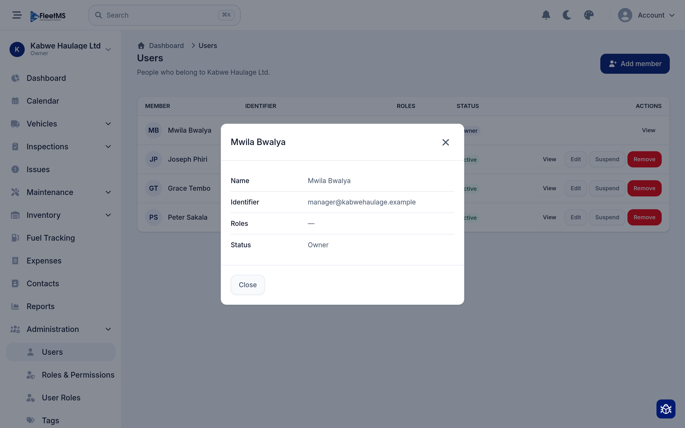
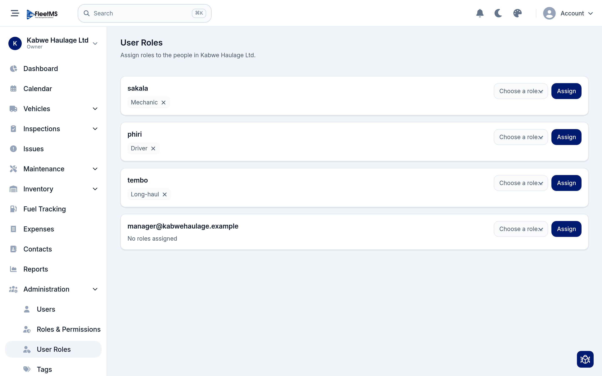
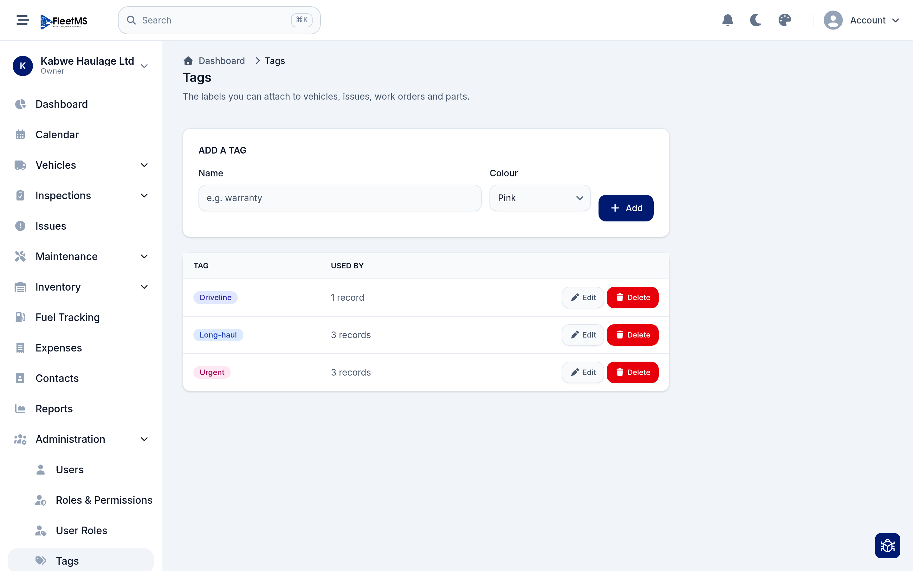
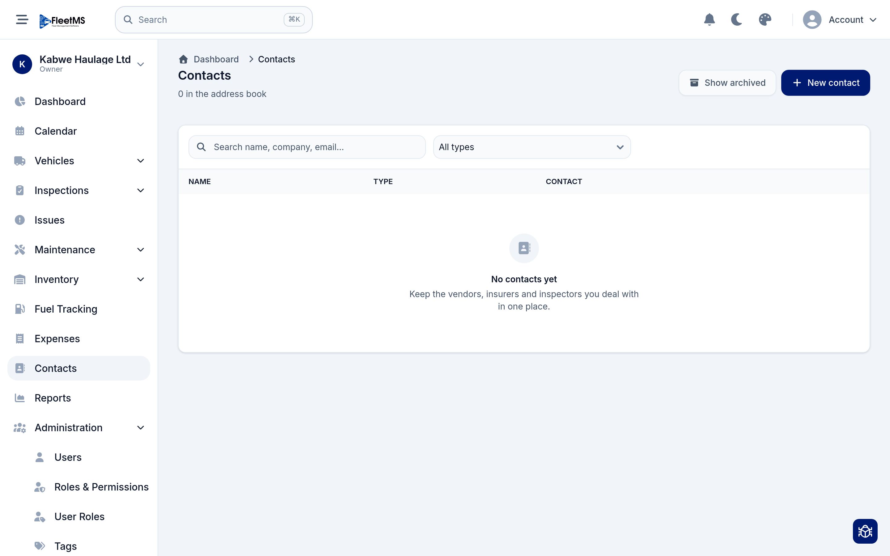

# People & administration (Admin / Owner)

The **Administration** section of the sidebar is where you manage the people in
your organization and the settings that shape it — members, roles, who has which
role, the tags used across the app, and your address book of outside contacts.

[Getting started](getting-started.md) already walked the first-time setup
(inviting people, choosing roles, organization settings). This guide is the fuller
reference for the Administration area you'll come back to.

**What's covered**

1. [The Administration menu](#1-the-administration-menu)
2. [Users — managing members](#2-users--managing-members)
3. [Roles & permissions](#3-roles--permissions)
4. [User roles — who has which role](#4-user-roles--who-has-which-role)
5. [Tags](#5-tags)
6. [Contacts](#6-contacts)
7. [Organization settings](#7-organization-settings)

---

## 1. The Administration menu

Expand **Administration** in the sidebar and you'll find:

- **Users** — the people who belong to your organization.
- **Roles & Permissions** — the roles and what each can do.
- **User Roles** — which roles each person has.
- **Tags** — the labels you attach to records across the app.

**Contacts** and **Organization Settings** live nearby too. Everything here is
scoped to your current organization — if you belong to more than one, switch with
the organization picker at the top of the sidebar first.

> Most of this section is only visible on a **Business / corporate** account. An
> **Individual** account hides members, roles and administration — see
> [Organization settings](#7-organization-settings).

---

## 2. Users — managing members

**Administration → Users** lists everyone who belongs to the organization. Click
**View** on a member to see their details.

Each member shows their **name**, **identifier** (email or username), their
**roles**, and a **status**. The **Owner** is marked as such and always has full
access. For everyone else, the row actions let you:

- **View** / **Edit** their details,
- **Suspend** them — they keep their account but can't sign in until reactivated
  (use this when someone is away or leaves temporarily),
- **Remove** them from the organization entirely.

To bring someone new in, use **Add member** — covered step by step in
[Getting started, step 5](getting-started.md#5-invite-your-team) (invite by email,
or create a username directly for a driver).

---

## 3. Roles & permissions

A **role** is a named bundle of permissions. **Administration → Roles &
Permissions** is where you review the built-in **system** roles (Administrator,
Read Only, Client) and create your own **custom** roles, then tick exactly what
each can do.

This is covered in full — including the difference between system and custom roles
and how to edit a role's permissions — in
[Getting started, step 4](getting-started.md#4-decide-who-can-do-what-roles).

> **Rule of thumb:** create the roles that match how your team works *before* you
> assign them, so you can pick the right one as you go.

---

## 4. User roles — who has which role

Roles only matter once people have them. **Administration → User Roles** is where
you assign roles to individuals.

Each person is listed with the roles they currently hold, shown as chips. To
change someone's access:

- **Add a role** — pick one from **Choose a role** and click **Assign**.
- **Remove a role** — click the **×** on its chip.

Someone can hold **more than one role**, and their access is the combination of
all of them. A person with **no roles assigned** can sign in but sees very
little until you give them a role.

---

## 5. Tags

**Tags** are the coloured labels you attach to vehicles, issues, work orders and
parts to group and filter them your own way. Open **Administration → Tags**.

Under **Add a tag**, give it a **name** and a **colour**, then **Add**. The table
below lists every tag, how many records it's **used by**, and lets you **Edit** or
**Delete** it. You can also create a tag on the fly while editing a vehicle,
issue, work order or part — this page is just where you manage the whole set.

> Tags are informal and entirely yours — use them for anything the built-in
> fields don't capture: *Long-haul*, *Urgent*, *Warranty*, a depot name, a
> customer.

---

## 6. Contacts

Contacts are your address book of the outside parties you deal with — vendors,
insurers, inspectors, suppliers. Open **Contacts** from the sidebar.

Click **New contact** to add one, giving their **name**, **type**, company and
contact details. Then **Search** and filter by **type** to find them, and
**Archive** ones you no longer deal with. Keeping them here means the people
behind your vendor labour and renewals are all in one place.

---

## 7. Organization settings

**Organization Settings** controls how the whole organization behaves and
displays — its **account type** (Business / corporate vs. Individual), **unit
system**, **default currency**, **timezone** and **date format**.

These are covered in
[Getting started, step 3](getting-started.md#3-set-up-your-organization). The one
worth repeating here: switching **account type** to **Individual** hides members,
roles and the whole Administration section for a one-person account — it changes
the UI only, never your data, and you can switch back at any time.

---

## Where to go next

That's the people and administration side covered. If you haven't yet, the
operational guides show what your team actually *does* day to day:

- [Managing your fleet](managing-fleet.md)
- [Day-to-day operations](day-to-day-operations.md)
- [Inspections](inspections.md)
- [Costs & reports](costs-and-reports.md)
- [Inventory](inventory.md)

See the [manual home](../README.md) for the full list.
