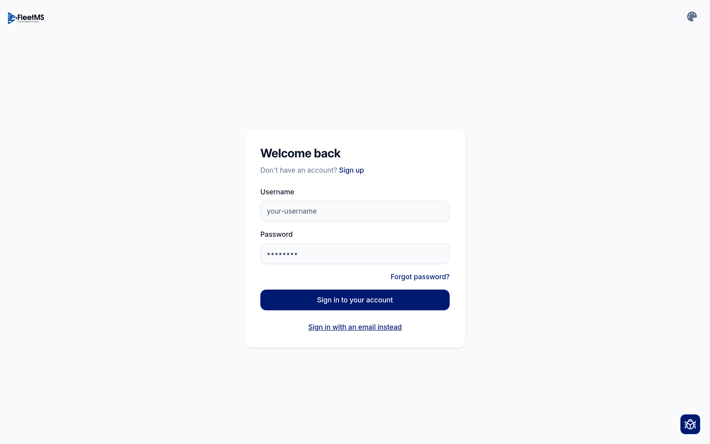
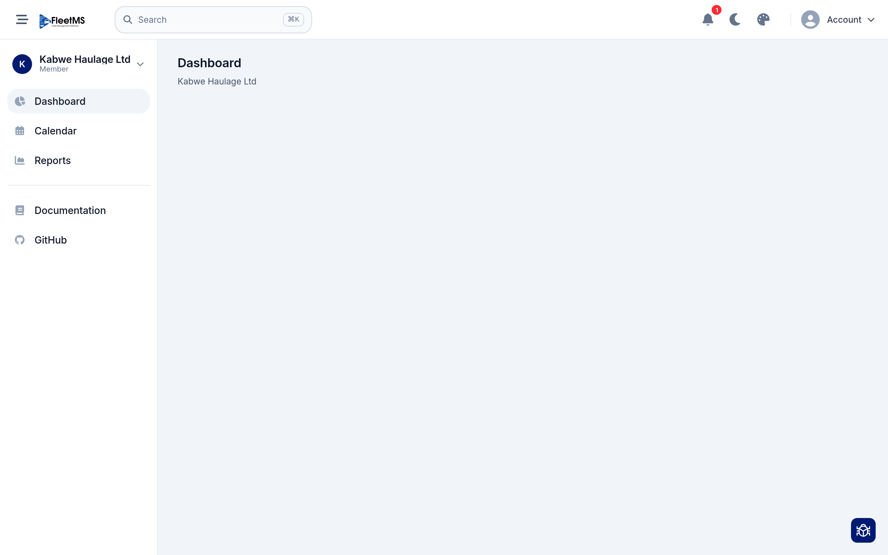
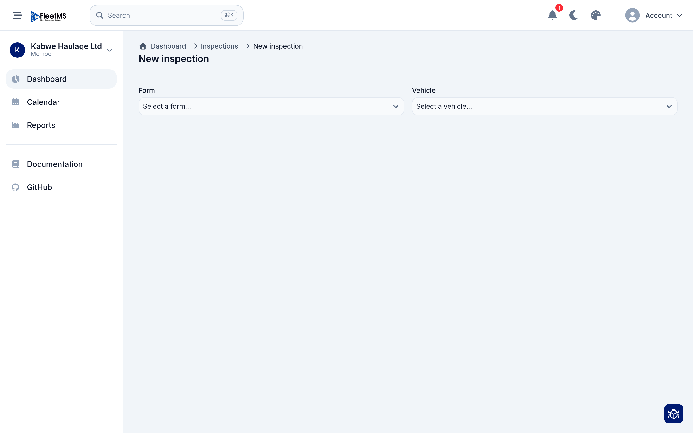
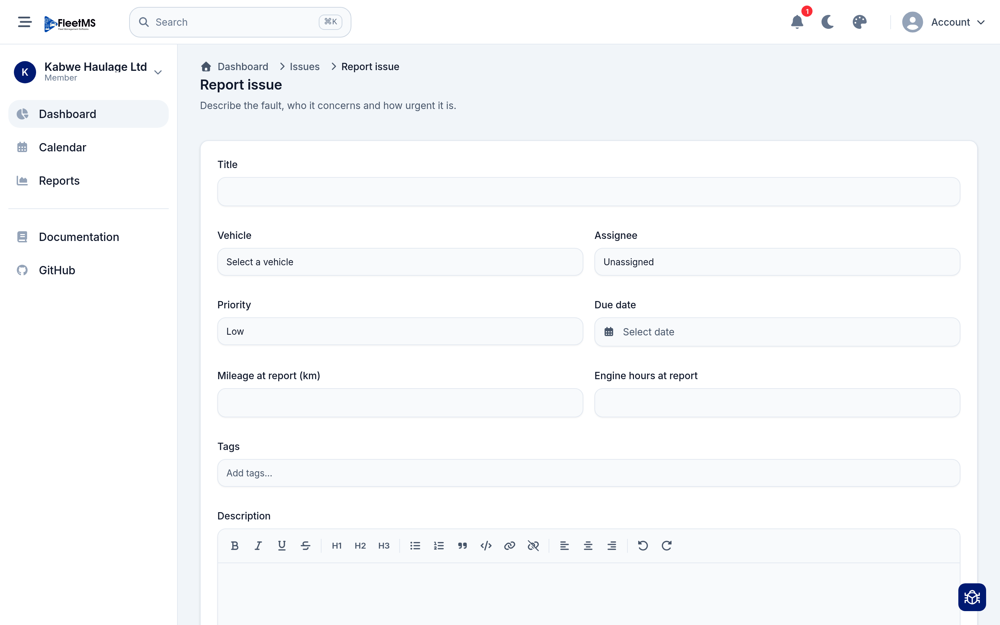
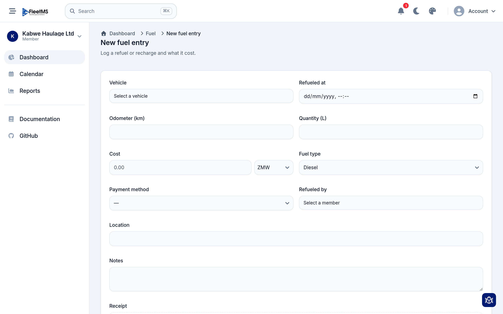

# For drivers: getting started

This short guide is for **drivers** — the people who operate the vehicles. It
covers the handful of things you'll actually do in FleetMS: sign in, check a
vehicle, report a fault, and log fuel. You don't need to know the rest of the
system; your manager sets that up.

Everything here works on a phone as well as a computer.

**What you'll do**

1. [Sign in](#1-sign-in)
2. [Do a vehicle inspection](#2-do-a-vehicle-inspection)
3. [Report a fault](#3-report-a-fault)
4. [Log fuel](#4-log-fuel)

---

## 1. Sign in

Your manager will have set up an account for you. You'll sign in with either an
**email** or a **username** — whichever they gave you.

- If you have a **username** (common for drivers), use the username form above.
  If you see the email form instead, tap **Sign in with a username instead**.
- If you have an **email**, tap **Sign in with an email instead** and use that.
- Enter your **password** and tap **Sign in to your account**.
- First time in? You may have received an email or a link to set your own
  password — do that first, then come back and sign in.

Once you're in, you'll see a simple home screen. Drivers get a **focused view** —
you only see the parts of the system you need, not the whole admin menu.

> **Put it on your phone.** FleetMS runs in your phone's browser and can be
> "installed" to your home screen like an app (your browser's **Add to Home
> Screen** option), so it's one tap away at the vehicle.

---

## 2. Do a vehicle inspection

An inspection is the walk-around check of a vehicle — lights, tyres, brakes and so
on. Your manager decides which checklist you use and when.

To start one, go to **New inspection**, then choose the **form** (the checklist)
and the **vehicle** you're checking.

Then work down the list. For each item:

- Mark it **Pass**, **Fail**, or **N/A**.
- Enter any readings it asks for (like the **odometer**).
- **If something fails**, the checklist will usually ask you to add a **comment**
  and a **photo** — do it there and then, at the vehicle. A clear photo and a line
  like *"nearside indicator not working"* is exactly what the workshop needs.

When you've been through everything, **submit**. Your manager sees the result
straight away, and any failures become jobs to fix.

> Take the photos as you go — it's much easier than trying to remember later.

---

## 3. Report a fault

Noticed something wrong that isn't part of a scheduled check — a warning light, a
noise, a crack? Report it as an **issue** so it doesn't get forgotten.

Go to **Report issue** and fill in:

- A short **title** — what's wrong (for example *"Brake squealing"*).
- The **vehicle** it's on.
- A **priority** — how urgent it is (Low / Medium / High).
- A **description** with the detail, and a photo if you can.

Tap submit and it's logged. Someone in the office will pick it up, and you can be
notified when it's dealt with.

> **Inspection vs. issue:** an **inspection** is the full checklist you're asked
> to complete; an **issue** is a single fault you're flagging any time you spot
> one. Use whichever fits.

---

## 4. Log fuel

When you fill up, record it so the office can track fuel and costs.

Go to **New fuel entry** and enter what you did:

- The **vehicle** and **when** you refuelled.
- The **odometer** reading (important — it's how the system works out fuel
  economy).
- The **quantity** (litres) and the **cost**.
- The **fuel type**, and optionally the **location**, a note, and a photo of the
  **receipt**.

Save it and you're done.

> The odometer reading matters most — try never to skip it. It's what turns your
> fuel entries into useful figures for the whole fleet.

---

## That's it

Those four things — **sign in, inspect, report, log fuel** — are the whole job in
FleetMS for most drivers. If a screen asks for something not covered here, it's
usually optional; fill in what you know and submit.

Anything you can't see or do is controlled by your manager, who decides what each
driver has access to. If you think you're missing something you need, ask them.

*A dedicated FleetMS mobile app for drivers is on the way; until then, the web app
on your phone does everything above.*
